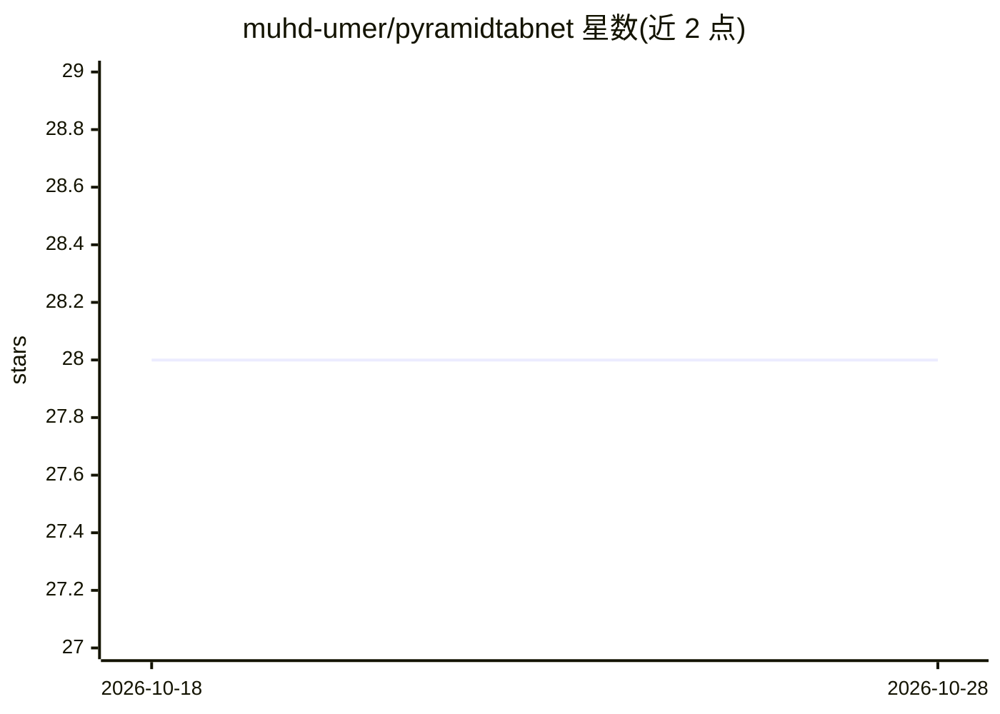

# muhd-umer/pyramidtabnet

⭐ 28 · Python · MIT · 推送 2026-06-08 · [GitHub](https://github.com/muhd-umer/pyramidtabnet) · [官网](https://doi.org/10.1007/978-3-031-41734-4_26) · 组织维护

**基于 Pyramid Vision Transformer 的文档图像表格检测与结构识别 PyTorch 实现**

ICDAR 2023 论文 PyramidTabNet 的官方 PyTorch 实现：使用无卷积的 Pyramid Vision Transformer 在文档图像中检测表格，并支持表格结构识别（含单元格检测）。配套提出三步（聚类、融合、补丁）的表格图像生成式数据增强方法用于训练。基于 MMDetection/mmcv 工具链训练与测试，提供 cTDaR TRACK A 测试集（COCO JSON 格式）、预训练权重下载脚本、训练/评估/检测/结构识别推理脚本及 Colab 运行方式。面向文档分析研究者与开发者。

## 筛选速览

| 维度 | 判定 | 备注 |
|---|---|---|
| AI 角色 | `ai-native` | 本体是模型或模型工具 |
| 许可风险 | `permissive` | MIT |
| 部署形态 | `library` | 以包/库形式分发 |
| 模型依赖 | — | README 未给出锁定关系 |
| 硬件要求 | — | 无带数字的原话,不猜 |
| 安装摩擦 | `medium` | 含编译或系统依赖之一 |
| 成熟度 | — | 结构信号不足 |

## 能力要点

- Pyramid Vision Transformer（无卷积）用于表格检测
- 聚类-融合-补丁三步表格图像生成式数据增强
- 支持表格检测与结构识别（含单元格检测）的推理脚本
- 提供预训练权重下载脚本与 cTDaR 测试集

## 适用场景

- 在文档图像中检测并定位表格
- 识别表格结构与单元格
- 复现论文训练或用数据增强生成训练样本

## 场景标签

`目标检测` `文档解析` · 领域:知识与检索

## 证据(README 行号)

> L14: In this paper, we introduce PyramidTabNet (PTN), a method that builds upon Convolution-less Pyramid Vision Transfor
> L10: > Presented at ICDAR 2023: International Conference on Document Analysis and Recognition

## 星数曲线

2026-10-18 28 → 2026-10-28 28（+0）

---
*卡片 v1 · prompt 1.4 · 生成 2026-10-26 · 置信度 high · 依据 README sha `3065d28e8b47` · [字段定义](../../DATASET.md)*
