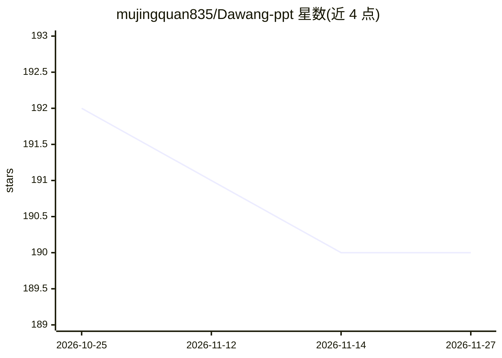

# mujingquan835/Dawang-ppt

⭐ 190 · JavaScript · AGPL-3.0 · 推送 2026-11-25 · [GitHub](https://github.com/mujingquan835/Dawang-ppt) · 个人维护 · 中文 README

**让 AI 从素材一键生成可编辑 HTML 与 PPTX 的中文演示组版引擎**

纯 Node 的确定性演示组版引擎，以 agent skill 形式接入 AI 客户端：读取原始文档、表格、截图与口述指令，经多源摄取（ingest v2）、版式解耦大纲预检（outline:lint）与 fast:build 管道，产出单文件离线可编辑 HTML 工作台、原生可编辑 PPTX、PDF/PNG。内置 35 套组件模块、每页 4 套零丢内容版式切换、11 套配色。面向需制作中文汇报的用户与开发者自动化流水线；要求 Node.js 22+。

## 筛选速览

| 维度 | 判定 | 备注 |
|---|---|---|
| AI 角色 | `ai-enhanced` | 去掉 AI 部分产品仍成立 |
| 许可风险 | `viral` | AGPL-3.0 |
| 部署形态 | `None` |  |
| 模型依赖 | — | README 未给出锁定关系 |
| 硬件要求 | — | 无带数字的原话,不猜 |
| 安装摩擦 | `low` | 无编译、无系统依赖或容器化 |
| 成熟度 | — | 结构信号不足 |

## 能力要点

- 35 套组件模块由原生几何图形与 SVG 构建，PPTX 原生可编辑导出
- 交付单文件离线 HTML 工作台，支持 4 套版式与 11 套配色一键切换
- 多源角色感知摄取：散装目录、粗版 PPT、历史参考与口述指令
- 纯 Node 引擎 <2 秒出稿，含实时 DOM 溢出检查

## 适用场景

- 把 Excel 业绩表和活动照片整理成季度工作汇报
- 项目复盘时自动生成问题→归因→解法对比页
- 自动化流水线批量产出汇报 PPTX

## 场景标签

`AI 写作` · 领域:内容生成

## 证据(README 行号)

> L5: 把原始文档、表格数据、现场截图与汇报要求交给 AI，通过极速纯 Node 确定性组版引擎一键生成**单文件离线可编辑 HTML 工作台**与**原生可编辑 PPTX**——无需云端服务，AI 一键直出现代 Web UI 级高精组件，
> L61: 确认输出 `ready: true` 后，在 AI 客户端（Claude Code / Codex / Cursor / Antigravity 等）中直接附上素材并说明需求即可，例如：

## 星数曲线

2026-10-25 192 → 2026-11-27 190（-2）

---
*卡片 v1 · prompt 1.4 · 生成 2026-11-26 · 置信度 high · 依据 README sha `9346442bc36a` · [字段定义](../../DATASET.md)*
