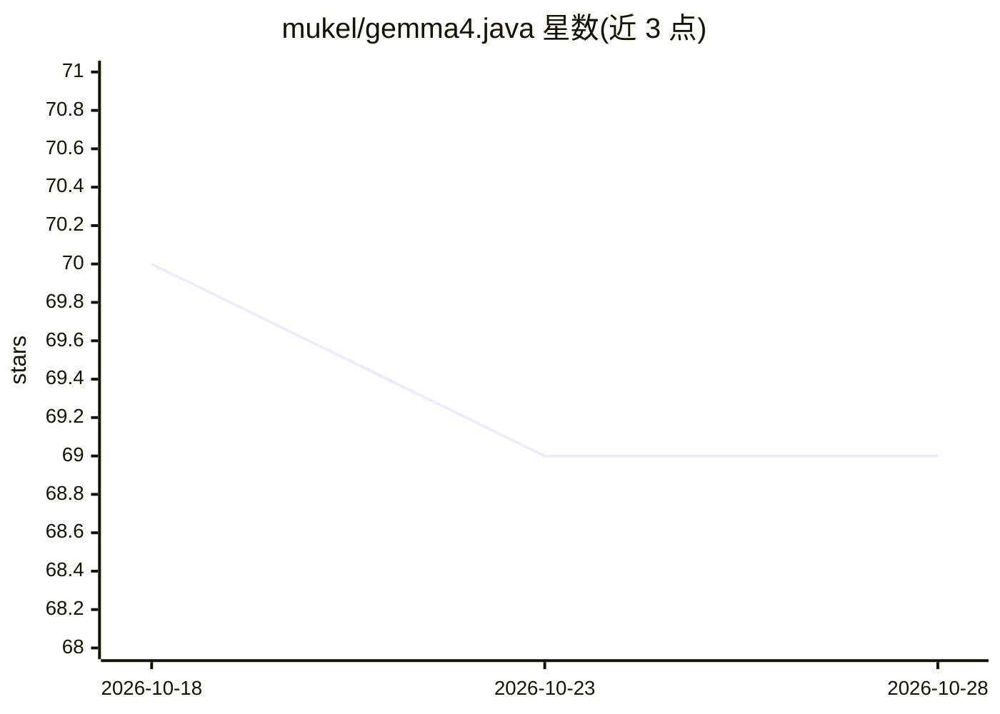

# mukel/gemma4.java

⭐ 69 · Java · Apache-2.0 · 推送 2026-04-24 · [GitHub](https://github.com/mukel/gemma4.java) · 个人维护

**纯 Java 实现的 Gemma 4 推理引擎，单文件零依赖**

面向 JVM 的 Gemma 4 模型推理引擎，单文件、零依赖，基于 llama3.java。支持 E2B/E4B/31B/26B-A4B(MoE) 全系列模型，解析 GGUF 格式，支持 F16/BF16/F32 及 Q4_0 到 Q8_0 多种量化。矩阵向量核使用 Java Vector API，提供 --chat/--prompt CLI 模式与思考模式开关；支持 GraalVM Native Image 编译与 AOT 模型预载以降低首 token 延迟。需 Java 21+，可经 jbang 一行命令运行，也可用 Makefile 打 jar 或编译原生可执行文件。

## 筛选速览

| 维度 | 判定 | 备注 |
|---|---|---|
| AI 角色 | `ai-ecosystem` | LLM/agent 周边工具 |
| 许可风险 | `permissive` | Apache-2.0 |
| 部署形态 | `None` |  |
| 模型依赖 | — | README 未给出锁定关系 |
| 硬件要求 | — | 无带数字的原话,不猜 |
| 安装摩擦 | `medium` | 含编译或系统依赖之一 |
| 成熟度 | — | 结构信号不足 |

## 能力要点

- 单文件零依赖，支持 Gemma 4 全系列模型（含 MoE 26B-A4B）
- GGUF 解析与 9 种 dtype/量化支持
- GraalVM Native Image 与 AOT 模型预载降低首 token 延迟
- 基于 Java Vector API 的矩阵向量核

## 适用场景

- 在 JVM 环境本地运行 Gemma 4 模型对话或单次推理
- 通过 GraalVM 原生编译获得快速启动的推理可执行文件
- Java 项目中以单文件形式集成 LLM 推理

## 场景标签

`推理引擎` · 领域:训练与推理

## 证据(README 行号)

> L8: Fast, zero-dependency, inference engine for Gemma 4 in pure Java.
> L12: - Single file, **no dependencies**, based on llama3.java

## 星数曲线

2026-10-18 70 → 2026-10-28 69（-1）

---
*卡片 v1 · prompt 1.4 · 生成 2026-10-24 · 置信度 high · 依据 README sha `dadd319031ef` · [字段定义](../../DATASET.md)*
