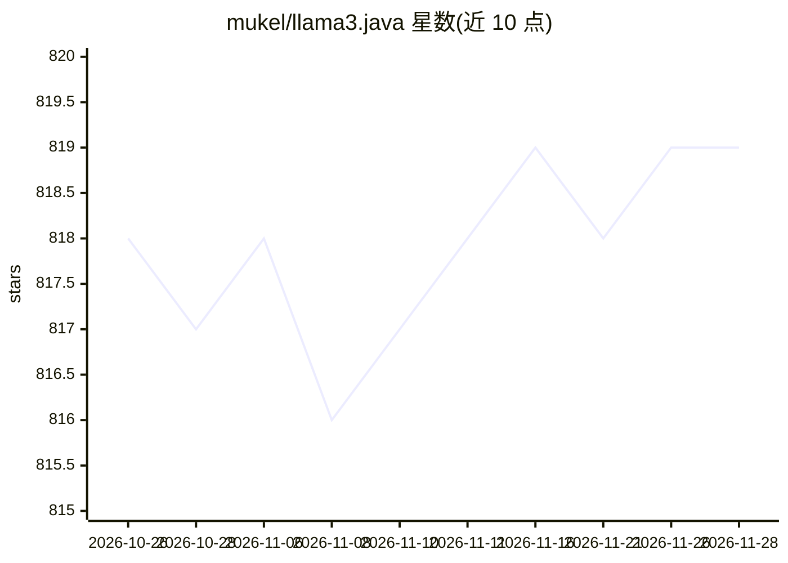

# mukel/llama3.java

⭐ 819 · Java · MIT · 推送 2026-11-26 · [GitHub](https://github.com/mukel/llama3.java) · 个人维护

**给 JVM/Java 开发者的单文件 Llama 3+ 本地推理实现**

以单个 Java 文件实现的 Llama 3/3.1/3.2 推理程序，无外部依赖，读取 GGUF 格式模型，支持 F16/BF16/F32 及多种量化权重，提供 --chat 与 --instruct 两种 CLI 模式。可用 jbang 直接运行或打包为 jar，也支持编译为 GraalVM Native Image 和 AOT 模型预加载。项目同时用于在 JVM 上测试和调优编译器优化，尤其是 Graal 编译器。需 Java 21+，依赖 Vector API（incubator 模块）。

## 筛选速览

| 维度 | 判定 | 备注 |
|---|---|---|
| AI 角色 | `ai-native` | 本体是模型或模型工具 |
| 许可风险 | `permissive` | MIT |
| 部署形态 | `None` |  |
| 模型依赖 | local-ok | 支持本地模型 |
| 硬件要求 | — | 无带数字的原话,不猜 |
| 安装摩擦 | `medium` | 含编译或系统依赖之一 |
| 成熟度 | — | 结构信号不足 |

## 能力要点

- 单文件、无依赖的 GGUF 解析与 Llama 3+ 推理（Grouped-Query Attention）
- 支持 Q4_0 至 Q8_0 多种量化权重与 Java Vector API 矩阵乘法
- GraalVM Native Image 编译与 AOT 模型预加载以降低 TTFT

## 适用场景

- 在 Java/JVM 环境本地运行 Llama 3 系列模型对话
- 学习 LLM 推理在 JVM 上的实现与编译器优化
- 为嵌入式/JVM 场景构建原生可执行推理程序

## 场景标签

`推理引擎` · 领域:训练与推理

## 证据(README 行号)

> L3: Practical Llama 3, 3.1 and 3.2 inference implemented in a single Java file.
> L16:  - GGUF format parser
> L22:  - Simple CLI with `--chat` and `--instruct` modes.

## 星数曲线

2026-10-26 818 → 2026-11-28 819（+1）

---
*卡片 v1 · prompt 1.4 · 生成 2026-11-28 · 置信度 high · 依据 README sha `4546002925af` · [字段定义](../../DATASET.md)*
