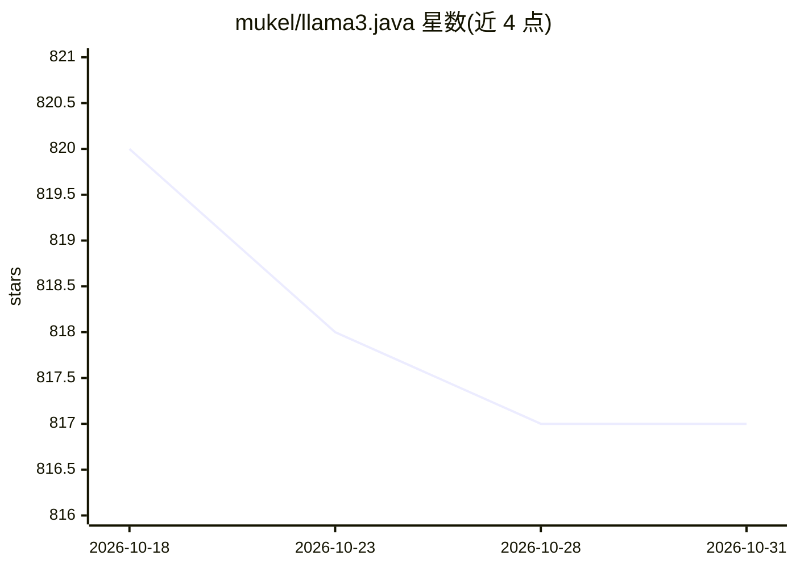

# mukel/llama3.java

⭐ 817 · Java · MIT · 推送 2026-04-24 · [GitHub](https://github.com/mukel/llama3.java) · 个人维护

**单文件纯 Java 实现的 Llama 3+ 推理引擎**

以单个 Java 文件实现 Llama 3/3.1/3.2 推理，无第三方依赖，基于 llama2.c/llama2.java 演进而来。支持 GGUF 格式解析、Grouped-Query Attention、F16/BF16/F32 及 Q4_0 到 Q8_0 多种量化、Java Vector API 加速的矩阵向量乘法，CLI 含 --chat 与 --instruct 模式。另支持 GraalVM Native Image 编译与 AOT 模型预载入以降低首 token 延迟。项目兼作 JVM（尤其 Graal 编译器）优化特性的测试载体，需 Java 21+，用 jbang 或 Makefile 构建运行。

## 筛选速览

| 维度 | 判定 | 备注 |
|---|---|---|
| AI 角色 | `ai-ecosystem` | LLM/agent 周边工具 |
| 许可风险 | `permissive` | MIT |
| 部署形态 | `None` |  |
| 模型依赖 | — | README 未给出锁定关系 |
| 硬件要求 | — | 无带数字的原话,不猜 |
| 安装摩擦 | `medium` | 含编译或系统依赖之一 |
| 成熟度 | — | 结构信号不足 |

## 能力要点

- 单文件、零依赖的纯 Java Llama 3+ 推理实现
- GGUF 解析与 Q4_0/Q4_1/Q4_K/Q5_K/Q6_K/Q8_0 量化支持
- GraalVM Native Image 编译与 AOT 模型预载入（即时首 token）
- Java Vector API 加速的矩阵向量乘法例程

## 适用场景

- 在 JVM 环境本地运行 Llama 3 系列模型做对话或指令推理
- 测试与调优 JVM/Graal 编译器的向量计算优化
- 以单文件形式学习 Llama 推理的实现结构

## 场景标签

`推理引擎` · 领域:训练与推理

## 证据(README 行号)

> L3: Practical Llama 3, 3.1 and 3.2 inference implemented in a single Java file.
> L8: Besides the educational value, this project will be used to test and tune compiler optimizations and features on the
> L18:  - Fast matrix-vector multiplication routines using Java's Vector API

## 星数曲线

2026-10-18 820 → 2026-10-31 817（-3）

---
*卡片 v1 · prompt 1.4 · 生成 2026-10-21 · 置信度 high · 依据 README sha `24f91ce51d73` · [字段定义](../../DATASET.md)*
