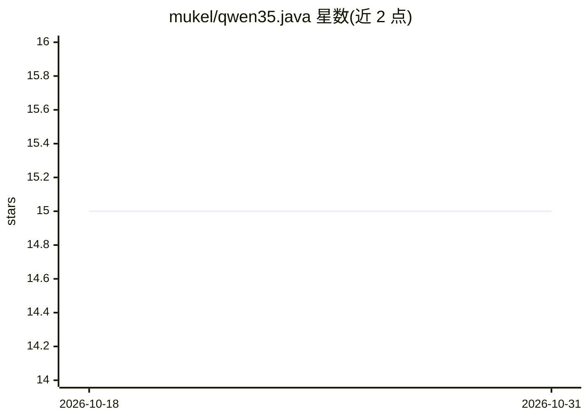

# mukel/qwen35.java

⭐ 15 · Java · Apache-2.0 · 推送 2026-05-10 · [GitHub](https://github.com/mukel/qwen35.java) · 个人维护

**纯 Java 的 Qwen 3.5 本地推理引擎**

单文件、零依赖的 Qwen 3.5 推理引擎，基于 llama3.java，支持 0.8B 至 35B-A3B（MoE）模型家族的 GGUF 权重，覆盖 F16/BF16/F32 与 Q4_0 到 Q8_0 多种量化。核心机制包括基于 Java Vector API 的矩阵向量核、MemorySegment mmap、GraalVM Native Image 编译与针对特定模型的 AOT 预载以缩短首 token 时间。通过 jbang 或 Makefile 构建运行，CLI 提供 chat 与 prompt 两种模式。限制：更大的 MoE 模型未测试。

## 筛选速览

| 维度 | 判定 | 备注 |
|---|---|---|
| AI 角色 | `ai-native` | 本体是模型或模型工具 |
| 许可风险 | `permissive` | Apache-2.0 |
| 部署形态 | `None` |  |
| 模型依赖 | — | README 未给出锁定关系 |
| 硬件要求 | — | 无带数字的原话,不猜 |
| 安装摩擦 | `medium` | 含编译或系统依赖之一 |
| 成熟度 | — | 结构信号不足 |

## 能力要点

- 单文件零依赖，纯 Java 实现 Qwen 3.5 推理
- 支持 Dense 与 MoE 架构、9 种 dtype/量化
- GraalVM Native Image 与 AOT 模型预载降低首 token 延迟
- 基于 Java Vector API 的矩阵向量核与 mmap 加载

## 适用场景

- 在 JVM 环境本地运行 Qwen 3.5 模型对话或补全
- 用 GraalVM 编译为本地可执行文件做低延迟推理
- 为特定量化模型生成预载专用二进制加速启动

## 场景标签

`推理引擎` · 领域:训练与推理

## 证据(README 行号)

> L8: Fast, zero-dependency, inference engine for Qwen 3.5 in pure Java.
> L13: - Supports **all** tested Qwen 3.5 model families: `0.8B`, `2B`, `4B`, `9B`, `27B`, and `35B-A3B` (MoE)

## 星数曲线

2026-10-18 15 → 2026-10-31 15（+0）

---
*卡片 v1 · prompt 1.4 · 生成 2026-10-30 · 置信度 high · 依据 README sha `644c276cb8b0` · [字段定义](../../DATASET.md)*
