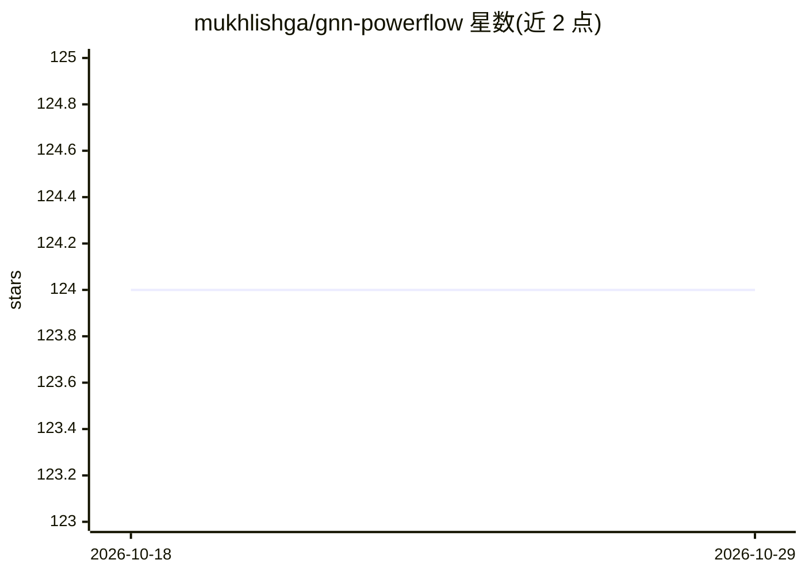

# mukhlishga/gnn-powerflow

⭐ 124 · Jupyter Notebook · 推送 2026-05-29 · [GitHub](https://github.com/mukhlishga/gnn-powerflow) · 个人维护

**用图神经网络预测交流潮流计算的研究代码（硕士论文）**

埃因霍温理工大学硕士论文配套代码，研究在同等模型复杂度（约2600可训练参数）下，将电网拓扑以图结构引入 GNN 是否能提升潮流预测精度，并与传统全连接网络对比。基于 PyTorch Geometric 在 Jupyter Notebook 中实现，比较三种架构：纯全连接、1层GNN、2层GNN+全连接输出。数据集由 DIgSILENT PowerFactory 2020 生成，共102个数据集（每个2000数据点，14节点、每节点2输入2输出特征），含环形拓扑变体以评估拓扑复杂度影响。README 未给出安装或运行命令，完整结果在附带 PDF 报告中。

## 筛选速览

| 维度 | 判定 | 备注 |
|---|---|---|
| AI 角色 | `ai-native` | 本体是模型或模型工具 |
| 许可风险 | `none` | — |
| 部署形态 | `None` |  |
| 模型依赖 | — | README 未给出锁定关系 |
| 硬件要求 | — | 无带数字的原话,不猜 |
| 安装摩擦 | `low` | 无编译、无系统依赖或容器化 |
| 成熟度 | — | 结构信号不足 |

## 能力要点

- 三种架构（FCNN / 1层GNN / 2层GNN）在约2600参数下对比
- 数据集由 DIgSILENT PowerFactory 2020 生成：102个数据集×2000数据点
- 第二组拓扑引入小/中/大环路，评估图拓扑复杂度影响
- 基于 PyTorch Geometric，在 Jupyter Notebook 中实现

## 适用场景

- 复现 GNN 潮流预测实验或查看论文实现细节
- 学习电网图建模（母线为节点、线路为边）与消息传递机制
- 作为电力系统 + GNN 交叉研究的参考代码

## 场景标签

 · 领域:电力系统/机器学习

## 证据(README 行号)

> L3: This study investigates the application of Graph Neural Networks (GNN) in electrical power systems, specifically for
> L25: Power Flow (PF) analysis commonly used to solve the unknown variables using electrical equations derived from the k

## 星数曲线

2026-10-18 124 → 2026-10-29 124（+0）

---
*卡片 v1 · prompt 1.4 · 生成 2026-10-23 · 置信度 high · 依据 README sha `f8c24f2488d7` · [字段定义](../../DATASET.md)*
