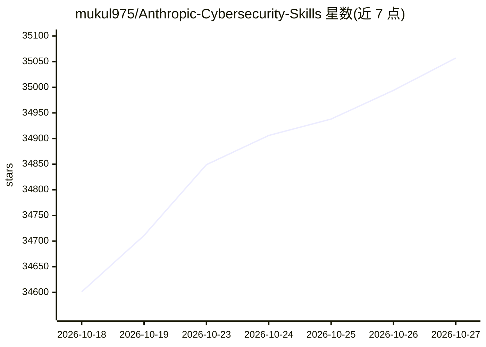

# mukul975/Anthropic-Cybersecurity-Skills

⭐ 35,057 · Python · Apache-2.0 · 推送 2026-08-31 · [GitHub](https://github.com/mukul975/Anthropic-Cybersecurity-Skills) · [官网](https://mahipal.engineer/Anthropic-Cybersecurity-Skills/) · 个人维护

**为 AI 代理提供网络安全技能库：818 条技能，映射 6 大框架**

面向 AI 代理的网络安全技能库，收录 818 条遵循 agentskills.io 标准的结构化技能，覆盖 34 个安全领域，并映射到 MITRE ATT&CK、NIST CSF 2.0、MITRE ATLAS、D3FEND、NIST AI RMF 与 MITRE F3 六个框架。每条技能以 YAML frontmatter 加 Markdown 正文组织，支持渐进式加载（扫描约 30 tokens，完整加载 500–2,000 tokens）。通过 npx 或 git clone 获取，可在 Claude Code、GitHub Copilot、Codex CLI、Cursor、Gemini CLI 等平台直接使用。README 声明为独立社区项目，与 Anthropic PBC 无隶属关系，并要求仅在授权合法场景下使用。

## 筛选速览

| 维度 | 判定 | 备注 |
|---|---|---|
| AI 角色 | `ai-knowledge` | 知识聚合/清单类 |
| 许可风险 | `permissive` | Apache-2.0 |
| 部署形态 | `library` | 以包/库形式分发 |
| 模型依赖 | — | README 未给出锁定关系 |
| 硬件要求 | — | 无带数字的原话,不猜 |
| 安装摩擦 | `low` | 无编译、无系统依赖或容器化 |
| 成熟度 | — | 结构信号不足 |

## 动量与使用信号

- 维护:`active` — 距上次 push 48.1 天,年发版 4,15 位贡献者
- 涨星:近 1 天 **+80**(自 20261016 起算)
- 安装:npm 包 `skills` 月下载 23,786,800
- 平台:— · 协议:MCP

## 能力要点

- 818 条技能覆盖 34 个安全领域，映射 6 个行业框架
- 每条技能带 YAML frontmatter，扫描约 30 tokens、完整加载 500–2,000 tokens 的渐进式披露架构
- ATT&CK v19.1 映射经官方 mitreattack-python 库校验，覆盖 290 个技术 ID
- 通过 npx skills add 或 git clone 安装，兼容 agentskills.io 标准平台

## 适用场景

- 给安全分析类 AI 代理加载内存取证、威胁狩猎等结构化工作流
- 按 MITRE ATT&CK/NIST CSF 框架组织团队的安全技能资产
- 用于红队、DFIR、渗透测试等授权安全场景的代理指导

## 场景标签

`网络安全` `精选清单` · 领域:学习与行业

## 证据(README 行号)

> L34: This repo contains **818 structured cybersecurity skills** spanning **34 security domains**, each following the age
> L137: **Anthropic Cybersecurity Skills** is not a collection of scripts or checklists. It is an **AI-native knowledge ba
> L101: Works immediately with Claude Code, GitHub Copilot, OpenAI Codex CLI, Cursor, Gemini CLI, and any agentskills.io-c

## 星数曲线

2026-10-18 34,601 → 2026-10-27 35,057（+456）

---
*卡片 v1 · prompt 1.4 · 生成 2026-10-18 · 置信度 high · 依据 README sha `6cce8399490c` · [字段定义](../../DATASET.md)*
