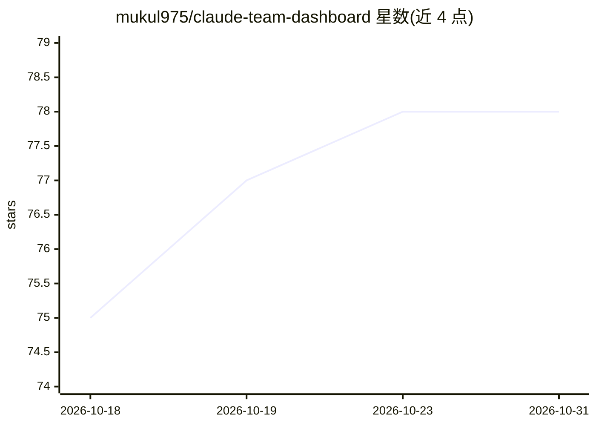

# mukul975/claude-team-dashboard

⭐ 78 · JavaScript · MIT · 推送 2026-05-25 · [GitHub](https://github.com/mukul975/claude-team-dashboard) · [官网](https://www.npmjs.com/package/claude-team-dashboard) · 个人维护

**Claude Code 多 agent 团队的实时监控仪表盘**

面向运行 Claude Code agent 团队的开发者：通过 WebSocket 实时流式展示各 agent 的状态、任务进度（进度条/状态徽章/依赖链）、agent 间消息往来（含完整历史与线程）、CPU/内存/网络指标及时间戳活动时间线。机制上以 chokidar 监听 ~/.claude/teams/*/inboxes/*.json 等本地文件变化并推送 inbox_update 事件，自动将技术性 agent 消息解析为四类人类可读消息。支持桌面通知、JSON/CSV 导出、PWA 离线查看；强制密码认证（scrypt 哈希）。npm 全局安装或 npx 直接运行，需 Node.js v18+。

## 筛选速览

| 维度 | 判定 | 备注 |
|---|---|---|
| AI 角色 | `ai-ecosystem` | LLM/agent 周边工具 |
| 许可风险 | `permissive` | MIT |
| 部署形态 | `library` | 以包/库形式分发 |
| 模型依赖 | — | README 未给出锁定关系 |
| 硬件要求 | — | 无带数字的原话,不猜 |
| 安装摩擦 | `low` | 无编译、无系统依赖或容器化 |
| 成熟度 | — | 结构信号不足 |

## 能力要点

- WebSocket 零轮询实时推送 agent 状态、任务与收件箱消息
- 监听 ~/.claude/teams/ 文件结构自动发现 agent 团队，零配置
- 技术性 agent 消息自动解析为四类可读消息（状态/完成/协调/提问）
- 密码认证（scrypt）+ 桌面通知 + JSON/CSV 导出 + PWA 离线查看

## 适用场景

- 同时跑多个 Claude Code agent 时查看各自在做什么
- 调试 agent 之间的协调与消息往来
- 追踪任务进度与系统资源占用，接收完成/错误桌面通知

## 场景标签

`LLM 可观测性` · 领域:评测与运维

## 证据(README 行号)

> L15: **Monitor, track, and orchestrate** your Claude Code agent teams from a **single, unified dashboard** — with **zero
> L215: The dashboard watches `~/.claude/teams/*/inboxes/*.json` with a dedicated chokidar watcher. Every time an inbox fi
> L172: - `~/.claude/teams/` — Active agent teams

## 星数曲线

2026-10-18 75 → 2026-10-31 78（+3）

---
*卡片 v1 · prompt 1.4 · 生成 2026-10-24 · 置信度 high · 依据 README sha `773d2ae91b2e` · [字段定义](../../DATASET.md)*
