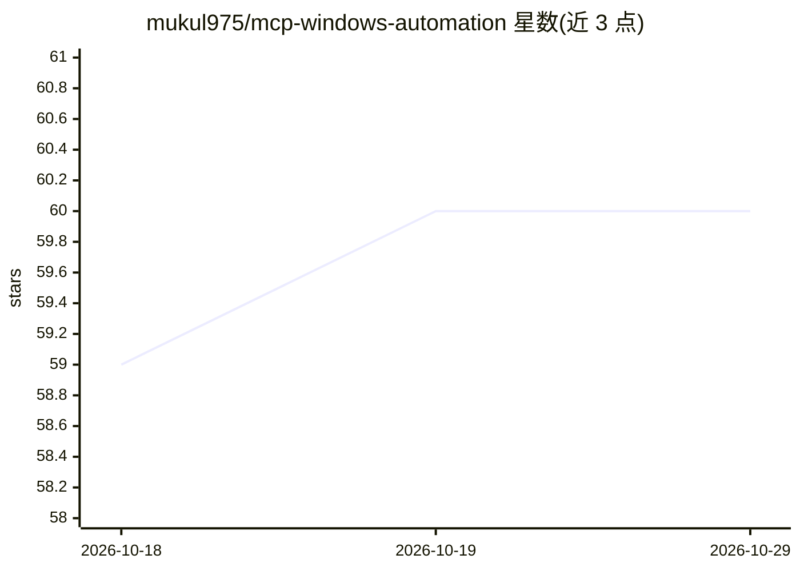

# mukul975/mcp-windows-automation

⭐ 60 · Python · MIT · 推送 2026-06-03 · [GitHub](https://github.com/mukul975/mcp-windows-automation) · 个人维护

**通过 MCP 让 AI 助手控制 Windows 的自动化服务器**

基于 Model Context Protocol 的 Windows 自动化服务器，向 Claude Desktop、ChatGPT 等 AI 助手暴露系统级自动化工具：进程/注册表/服务管理、文件操作、浏览器自动化、截图与 OCR、Office 自动化、网络诊断等类别，README 标称 200+ 工具。内置命令过滤与安全执行机制，采用插件化架构，支持可选 MySQL 集成。以 pip 包（mcp-windows-server）分发，仅支持 Windows 平台，需 Python 3.10+。

## 筛选速览

| 维度 | 判定 | 备注 |
|---|---|---|
| AI 角色 | `ai-ecosystem` | LLM/agent 周边工具 |
| 许可风险 | `permissive` | MIT |
| 部署形态 | `library` | 以包/库形式分发 |
| 模型依赖 | locked-api |  |
| 硬件要求 | — | 无带数字的原话,不猜 |
| 安装摩擦 | `low` | 无编译、无系统依赖或容器化 |
| 成熟度 | — | 结构信号不足 |

## 能力要点

- 实现 MCP 协议，供 Claude/ChatGPT 等 AI 助手调用 Windows 系统工具
- 覆盖系统控制、文件、网页、图像处理、Office、网络等类别的自动化工具
- 内置命令过滤与受控执行的安全机制
- 插件化架构，支持扩展自定义自动化

## 适用场景

- 在 Claude Desktop 中用自然语言操作 Windows 系统与文件
- 通过 AI 助手执行截图、OCR、Office 文档处理等桌面任务
- 以 MCP 工具形式为 AI 客户端接入 Windows 自动化能力

## 场景标签

`GUI 自动化` `浏览器自动化` · 领域:效率与自动化

## 证据(README 行号)

> L13: **MCP Windows Server** is an AI-native automation framework that enables AI assistants to control Windows systems t
> L17: MCP is an open protocol by Anthropic that allows AI models to interact safely with local tools, APIs, and system se
> L45: ### Claude Desktop Integration

## 星数曲线

2026-10-18 59 → 2026-10-29 60（+1）

---
*卡片 v1 · prompt 1.4 · 生成 2026-10-24 · 置信度 high · 依据 README sha `6da2dd1cee8b` · [字段定义](../../DATASET.md)*
