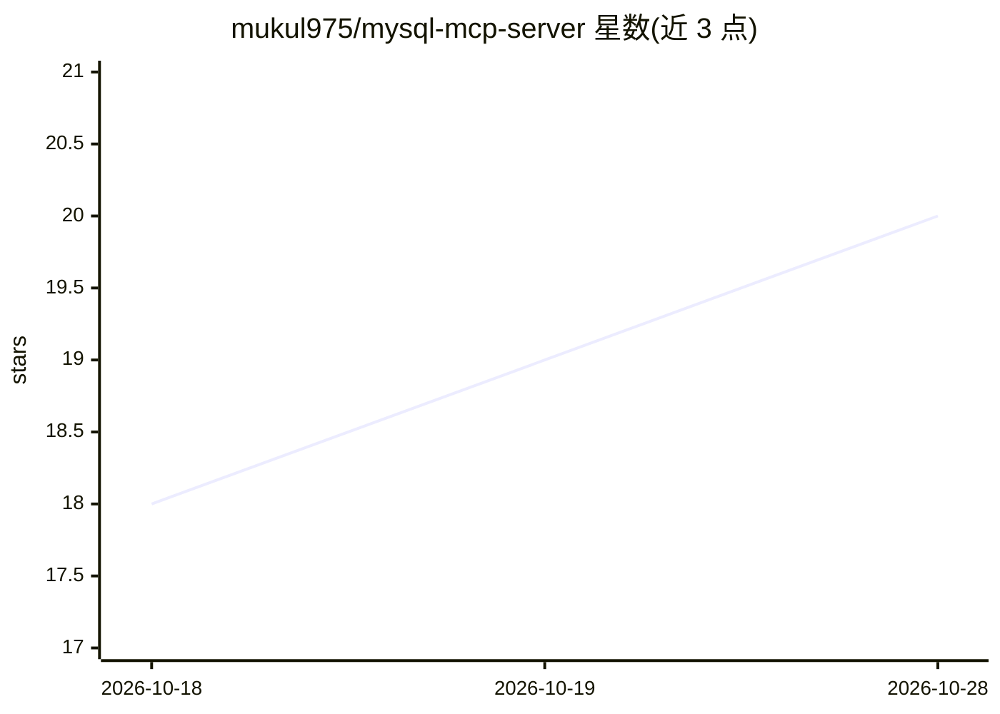

# mukul975/mysql-mcp-server

⭐ 21 · Python · MIT · 推送 2026-10-07 · [GitHub](https://github.com/mukul975/mysql-mcp-server) · 个人维护

**面向 AI 客户端的 MySQL MCP 服务器，提供查询与运维工具**

基于 Python（FastAPI）的 Model Context Protocol 服务器，将 MySQL 数据库操作以 MCP 工具形式暴露给 AI 客户端：支持只读查询、InnoDB 性能分析、慢查询与死锁分析、用户权限管理、复制延迟监控、SSL 审计等大量诊断与运维工具。提供 HTTP 端点（/health、/tools、/invoke），支持 stdio 与 SSE 两种传输；安全机制含 Bearer/API Key 认证、速率限制、Pydantic 输入校验与只读查询限制。通过 pip 或 Docker 安装，可接入 Claude Desktop。

## 筛选速览

| 维度 | 判定 | 备注 |
|---|---|---|
| AI 角色 | `ai-ecosystem` | LLM/agent 周边工具 |
| 许可风险 | `permissive` | MIT |
| 部署形态 | `self-host` | docker 或自建部署 |
| 模型依赖 | — | README 未给出锁定关系 |
| 硬件要求 | — | 无带数字的原话,不猜 |
| 安装摩擦 | `low` | 无编译、无系统依赖或容器化 |
| 成熟度 | — | 结构信号不足 |

## 能力要点

- 提供只读 SQL 执行、表结构/索引/碎片化分析等工具集
- 支持 stdio 与 SSE 两种 MCP 传输方式
- 安全机制：认证、速率限制、输入校验、只读查询限制
- 提供 Docker Compose 部署与 /health、/tools、/invoke HTTP 端点

## 适用场景

- 让 Claude Desktop 等 MCP 客户端直接查询和分析 MySQL 数据库
- 通过 AI 客户端执行慢查询、死锁与复制延迟等诊断
- 对 MySQL 用户权限与 SSL 配置进行审计

## 场景标签

 · 领域:数据库管理/AI 工具服务

## 证据(README 行号)

> L9: A production-ready **Model Context Protocol (MCP) server** for MySQL database operations. Provides secure HTTP endpo
> L207: To integrate with Claude Desktop, update your config file (`%APPDATA%/Claude/claude_desktop_config.json` on Window

## 星数曲线

2026-10-18 18 → 2026-10-28 20（+2）

---
*卡片 v1 · prompt 1.4 · 生成 2026-10-28 · 置信度 high · 依据 README sha `ab77bfea1ca3` · [字段定义](../../DATASET.md)*
