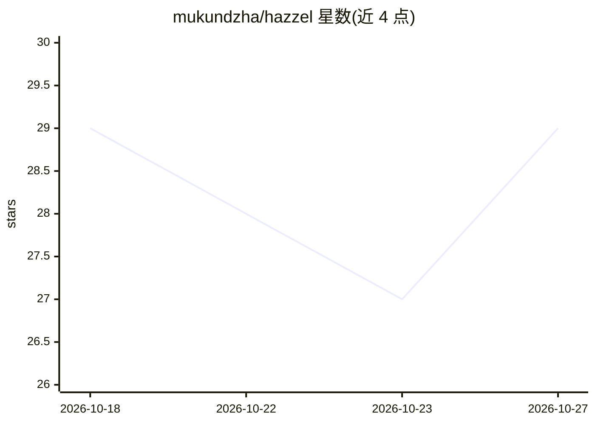

# mukundzha/hazzel

⭐ 29 · Python · Apache-2.0 · 推送 2026-10-26 · [GitHub](https://github.com/mukundzha/hazzel) · [官网](https://agenthazzel.vercel.app) · 个人维护

**终端编码 Agent：每次写入前以 diff 展示并需批准**

约 1 万行 Python 的终端编码代理，接入 8 家 LLM 提供商（Groq/OpenAI/Anthropic/Mistral/Gemini/DeepSeek/OpenRouter/Ollama），BYOK 无订阅。核心机制：所有写操作先展示 diff 并经用户批准；写入前自动快照到本地支持选择性 /undo 与 /redo；shell 命令沙箱限定在项目根目录。支持 git 命令组、MCP stdio 客户端、SKILL.md 技能、按 token 记账与预算、管道模式 hazzel -p。作者自述 v1.6.1 早期阶段，无自主 PR、无云仪表盘。

## 筛选速览

| 维度 | 判定 | 备注 |
|---|---|---|
| AI 角色 | `ai-native` | 本体是模型或模型工具 |
| 许可风险 | `permissive` | Apache-2.0 |
| 部署形态 | `library` | 以包/库形式分发 |
| 模型依赖 | local-ok | 支持本地模型 |
| 硬件要求 | — | 无带数字的原话,不猜 |
| 安装摩擦 | `low` | 无编译、无系统依赖或容器化 |
| 成熟度 | `idea` | |

## 能力要点

- 每次写操作先呈现 diff 供批准，含 shell 命令
- 自动检查点到本地，/undo 保留用户后续编辑、/redo 重放
- 8 家提供商 BYOK 接入，含 Ollama 全本地免密钥
- MCP stdio 客户端（仅标准库）与 SKILL.md 技能按需加载

## 适用场景

- 在终端里让 AI 修复失败测试或提交代码，逐 diff 审查改动
- 用本地 Ollama 模型零成本跑编码代理
- CI 中以 hazzel -p 单轮运行并输出 JSON

## 场景标签

`编码 Agent` · 领域:编码与开发

## 证据(README 行号)

> L5:  A terminal coding agent you can actually read.
> L23: Every agent claims transparency. Hazzel is ~10k lines of Python you can trace end to end — `agent/core.py` is the w
> L105: |Groq|`GROQ_API_KEY`|default model runs here|

## 星数曲线

2026-10-18 29 → 2026-10-27 29（+0）

---
*卡片 v1 · prompt 1.4 · 生成 2026-10-26 · 置信度 high · 依据 README sha `1d2802a1c57a` · [字段定义](../../DATASET.md)*
