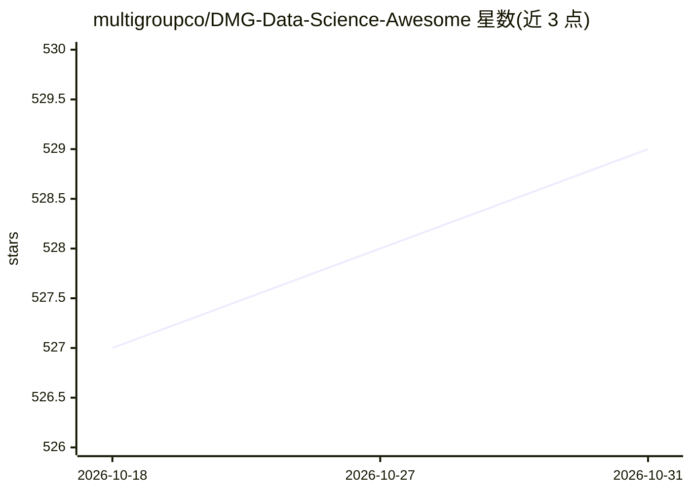

# multigroupco/DMG-Data-Science-Awesome

⭐ 529 · MIT · 推送 2026-05-11 · [GitHub](https://github.com/multigroupco/DMG-Data-Science-Awesome) · 组织维护

**数据科学学习资源清单：土耳其语的学习路线与教程合集**

由 MultiGroup（DevMultiGroup）维护的土耳其语数据科学资源汇总清单，按结构化与非结构化主题组织为 10 余个板块：Python & SQL、数据科学、机器学习、数据书籍、数据论文、生成式 AI、NLP、深度学习、计算机视觉、MLOps 与云等。每条目附土耳其语简介，覆盖课程、博客、视频教程、数据集、RAG 与 Agent 教程及论文实现，并配套线上活动 DataCommit 的资源归档，接受社区按贡献指南提交。

## 筛选速览

| 维度 | 判定 | 备注 |
|---|---|---|
| AI 角色 | `ai-knowledge` | 知识聚合/清单类 |
| 许可风险 | `permissive` | MIT |
| 部署形态 | `None` |  |
| 模型依赖 | — | README 未给出锁定关系 |
| 硬件要求 | — | 无带数字的原话,不猜 |
| 安装摩擦 | `low` | 无编译、无系统依赖或容器化 |
| 成熟度 | — | 结构信号不足 |

## 能力要点

- 按 10 余个主题板块组织的学习资源清单
- 覆盖课程/博客/视频/数据集/论文等多类型条目
- 生成式 AI 板块包含 RAG、Agent、LLM 教程与论文实现资源
- 配套 DataCommit 线上活动资源与贡献指南

## 适用场景

- 系统查找数据科学与机器学习入门到进阶的学习资源
- 按主题浏览生成式 AI、RAG 与 Agent 的教程和课程
- 查找土耳其语的数据科学学习资料与本地化资源

## 场景标签

`精选清单` · 领域:学习与行业

## 证据(README 行号)

> L25: # 📑Table of Contents
> L144: ## 🤖Generative AI

## 星数曲线

2026-10-18 527 → 2026-10-31 529（+2）

---
*卡片 v1 · prompt 1.4 · 生成 2026-10-21 · 置信度 high · 依据 README sha `7d5c566866bc` · [字段定义](../../DATASET.md)*
