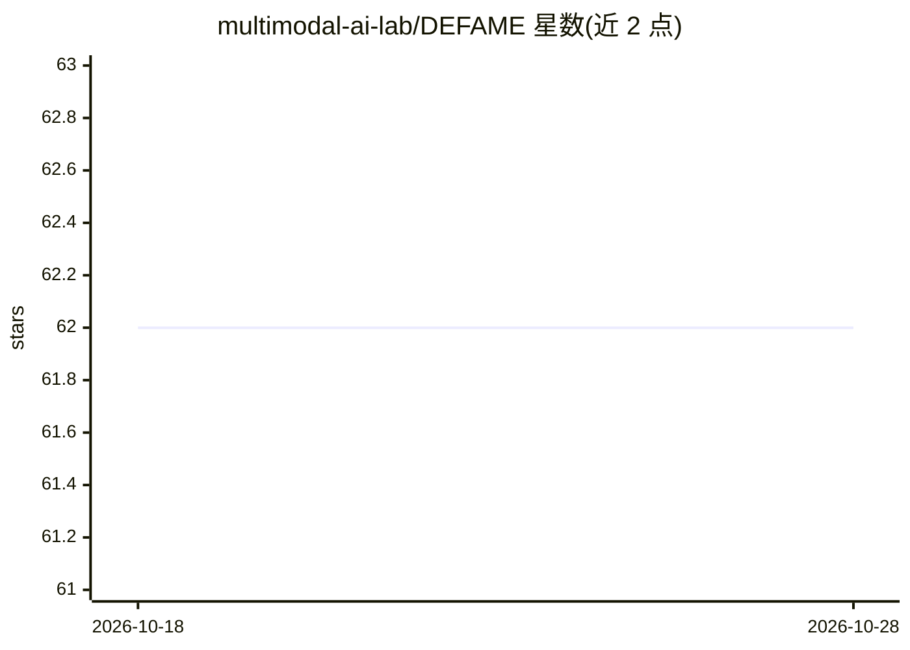

# multimodal-ai-lab/DEFAME

⭐ 62 · Python · Apache-2.0 · 推送 2026-05-21 · [GitHub](https://github.com/multimodal-ai-lab/DEFAME) · 组织维护

**多模态事实核查系统：验证图文声明的真实性**

将事实核查任务分解为动态 6 阶段流水线，以 MLLM 为骨干执行规划、推理与证据摘要等子任务，通过可扩展的 Tool 体系（网页搜索、反向图片搜索、网页抓取等）检索证据，对任意图文声明输出核查判定。默认配置使用 GPT-4o，也可经 Hugging Face 使用 Llama/Llava 等开源模型。支持 Docker 或手动安装，可跑 AVeriTeC/MOCHEG/VERITE/ClaimReview2024+ 基准评测，自带 HTTP API 与可自托管的 Web 界面；对应 ICML 2025 论文。

## 筛选速览

| 维度 | 判定 | 备注 |
|---|---|---|
| AI 角色 | `ai-native` | 本体是模型或模型工具 |
| 许可风险 | `permissive` | Apache-2.0 |
| 部署形态 | `self-host` | docker 或自建部署 |
| 模型依赖 | — | README 未给出锁定关系 |
| 硬件要求 | `cpu-ok` | |
| 安装摩擦 | `low` | 无编译、无系统依赖或容器化 |
| 成熟度 | — | 结构信号不足 |

## 能力要点

- 动态 6 阶段多模态事实核查流水线，以 MLLM 为骨干
- 可插拔 Tool 体系：Serper/DuckDuckGo 搜索、Google Vision/Firecrawl 反向图搜、Firecrawl 网页抓取
- 支持 GPT-4o 及经 Hugging Face 的 Llama/Llava 开源模型
- 提供 API 后端与可自托管 Web 界面，支持 4 个基准评测

## 适用场景

- 我对网上的图文声明做真实性核查
- 我在事实核查基准（AVeriTeC/VERITE 等）上评测系统
- 我通过 HTTP API 把核查能力接入自己的应用

## 场景标签

`多模态` · 领域:感知与多模态

## 证据(README 行号)

> L7: This is the implementation of **Dynamic Evidence-based FAct-checking with Multimodal Experts (DEFAME)**, a strong mu
> L86: With `scripts/run.py`, you can fact-check any image-text claim. The script already contains an example. Execute it 

## 星数曲线

2026-10-18 62 → 2026-10-28 62（+0）

---
*卡片 v1 · prompt 1.4 · 生成 2026-10-24 · 置信度 mid · 依据 README sha `a6c2b4689c72` · [字段定义](../../DATASET.md)*
