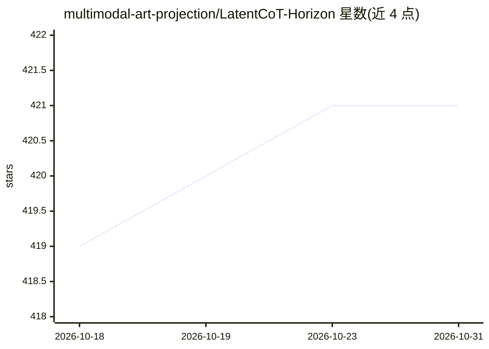

# multimodal-art-projection/LatentCoT-Horizon

⭐ 421 · 推送 2025-11-05 · [GitHub](https://github.com/multimodal-art-projection/LatentCoT-Horizon) · [官网](https://arxiv.org/abs/2507.06203) · 组织维护 · 中文 README

**潜在推理（Latent Reasoning）方向的论文清单，配套综述引用**

M-A-P 团队维护的 Latent Reasoning 论文与资源聚合仓库，收录其 arXiv 综述 'A Survey on Latent Reasoning' 提到的论文。内容按潜在 CoT 推理（架构循环/训练诱导循环/训练策略/应用）、时序隐状态方法、机制可解释性等类别组织成表格，每条含标题、会议/期刊、日期与论文/代码链接。面向从事 LLM 推理研究的科研人员，通过 issue/邮件/PR 接收新条目，仓库承诺随新研究出现持续更新。

## 筛选速览

| 维度 | 判定 | 备注 |
|---|---|---|
| AI 角色 | `ai-knowledge` | 知识聚合/清单类 |
| 许可风险 | `none` | — |
| 部署形态 | `None` |  |
| 模型依赖 | — | README 未给出锁定关系 |
| 硬件要求 | — | 无带数字的原话,不猜 |
| 安装摩擦 | `low` | 无编译、无系统依赖或容器化 |
| 成熟度 | — | 结构信号不足 |

## 能力要点

- 对应 arXiv 综述 'A Survey on Latent Reasoning'（2025-07）的配套论文清单
- 按方法类别分层组织（架构循环、训练诱导、隐状态、机制可解释性等）
- 每条目含 venue、日期、Paper/Code 链接
- 通过 PR 与邮件接受社区新增条目

## 适用场景

- 查找潜在推理方向的论文与开源代码
- 跟进循环 Transformer、隐状态方法等子方向的研究进展
- 作为综述 'A Survey on Latent Reasoning' 的阅读配套索引

## 场景标签

`精选清单` · 领域:学习与行业

## 证据(README 行号)

> L14: This repository provides the papers mentioned in the survey "A Survey on Latent Reasoning".
> L60: ## 📜 Papers
> L62: ### 🧠 Latent CoT Reasoning

## 星数曲线

2026-10-18 419 → 2026-10-31 421（+2）

---
*卡片 v1 · prompt 1.4 · 生成 2026-10-23 · 置信度 high · 依据 README sha `9e9fa0495af9` · [字段定义](../../DATASET.md)*
