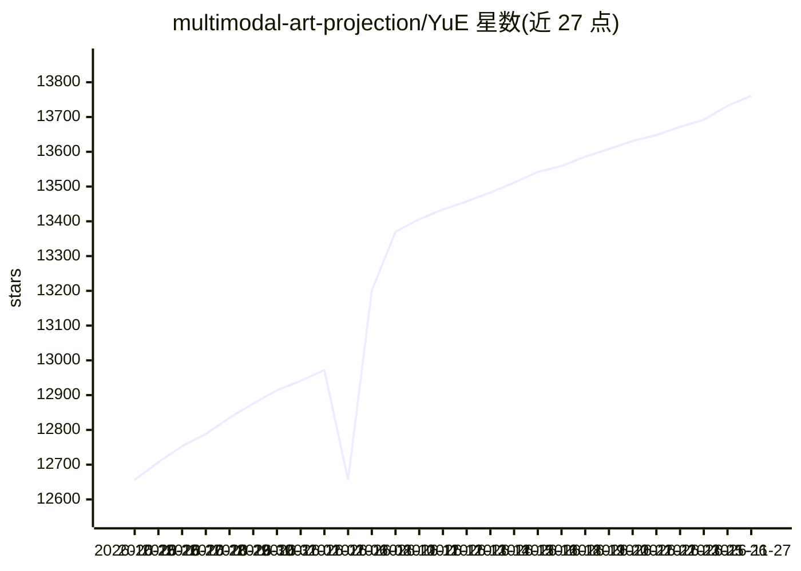

# multimodal-art-projection/YuE

⭐ 13,761 · Python · Apache-2.0 · 推送 2026-11-01 · [GitHub](https://github.com/multimodal-art-projection/YuE) · [官网](https://map-yue2.github.io/) · 组织维护

**面向创作者的歌词到歌曲生成模型，支持符号规划、翻唱与编辑**

YuE2 是开源歌曲生成模型：输入歌词与风格提示，先生成可读可改的旋律-和弦计划（ABC 乐谱），再渲染为带人声与伴奏的完整 48 kHz 立体声歌曲。架构为 AR–NAR Mixture-of-Transformers，配合 flow matching 与 VAE 解码。同一检查点支持零样本翻唱（经 SheetSage2 转写参考录音）与基于乐谱对话的 agentic 编辑。分阶段 Python API 暴露 plan→generate_semantic→synthesize→decode。默认路径需要 NVIDIA GPU、24 GB VRAM 与 Python 3.12，Linux 之外为实验性支持。

## 筛选速览

| 维度 | 判定 | 备注 |
|---|---|---|
| AI 角色 | `ai-native` | 本体是模型或模型工具 |
| 许可风险 | `permissive` | Apache-2.0 |
| 部署形态 | `library` | 以包/库形式分发 |
| 模型依赖 | — | README 未给出锁定关系 |
| 硬件要求 | `gpu-24g` | |
| 安装摩擦 | `low` | 无编译、无系统依赖或容器化 |
| 成熟度 | — | 结构信号不足 |

## 能力要点

- 符号规划：旋律与和弦以 ABC 乐谱形式可读、可改、可复用
- 同一检查点支持创作、零样本翻唱与乐谱级 agentic 编辑
- 提供 yue2-music agent skill 与 ComfyUI 原生节点
- 附带 MERT2 音乐理解与 SheetSage2 音频转谱模型

## 适用场景

- 给歌词和风格描述生成带人声的完整歌曲
- 把一段录音翻唱成新风格的版本
- 通过修改乐谱对话式迭代调整编曲与和声

## 场景标签

`语音合成` · 领域:内容生成

## 证据(README 行号)

> L42: **YuE2 brings frontier song quality to music generation with an editable composition.** Give it lyrics and a style 
> L86: One **AR–NAR Mixture-of-Transformers** backbone predicts the score and semantic tokens autoregressively, then gener
> L92: **Linux · Python 3.12 · NVIDIA GPU with BF16 support and 24 GB VRAM.** YuE2 produces 48 kHz stereo audio without qu

## 星数曲线

2026-10-25 12,656 → 2026-11-27 13,761（+1,105）

---
*卡片 v1 · prompt 1.4 · 生成 2026-11-23 · 置信度 high · 依据 README sha `3411884582ea` · [字段定义](../../DATASET.md)*
