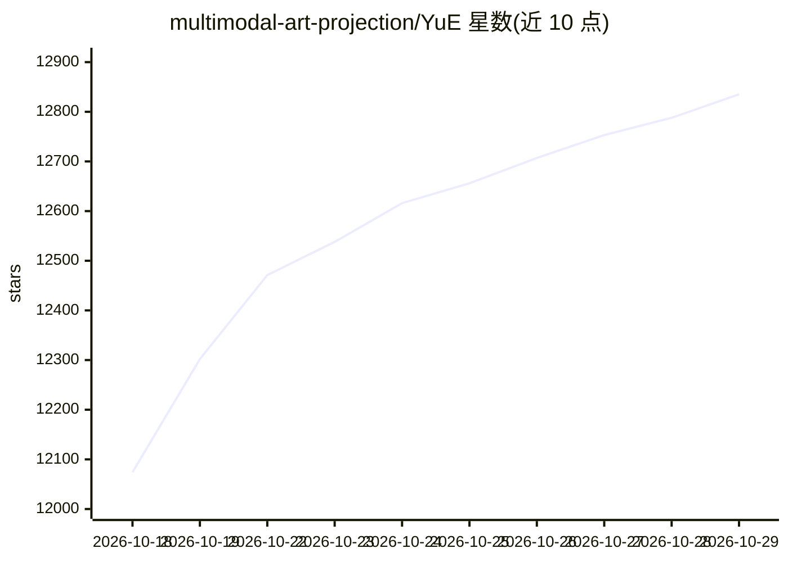

# multimodal-art-projection/YuE

⭐ 12,835 · Python · Apache-2.0 · 推送 2026-10-06 · [GitHub](https://github.com/multimodal-art-projection/YuE) · [官网](https://map-yue2.github.io/) · 组织维护

**歌词+风格生成完整歌曲的音乐模型，支持符号乐谱规划与编辑**

YuE2 是歌词与风格提示驱动的歌曲生成模型：先用 AR–NAR Mixture-of-Transformers 骨干生成可编辑的旋律与和弦乐谱（符号规划），再经 flow matching 生成声学潜变量并由 VAE 解码为 48kHz 立体声音频。同一生成检查点支持三种模式：从歌词创作新歌、基于 SheetSage2 转录的零样本翻唱、以及通过对话编辑乐谱后重新渲染。以 Python API 与示例脚本提供，附带面向 agent 的 yue2-music 技能包。运行需 Linux、Python 3.12、支持 BF16 且显存 24GB 的 NVIDIA GPU。

## 筛选速览

| 维度 | 判定 | 备注 |
|---|---|---|
| AI 角色 | `ai-native` | 本体是模型或模型工具 |
| 许可风险 | `permissive` | Apache-2.0 |
| 部署形态 | `library` | 以包/库形式分发 |
| 模型依赖 | — | README 未给出锁定关系 |
| 硬件要求 | `gpu-24g` | |
| 安装摩擦 | `low` | 无编译、无系统依赖或容器化 |
| 成熟度 | — | 结构信号不足 |

## 能力要点

- 符号乐谱规划：生成前可读取、演奏、编辑旋律与和弦
- 零样本翻唱与 agentic 乐谱编辑共用同一生成检查点
- 分阶段 Python API：plan→generate_semantic→synthesize→decode
- 附带 yue2-music agent 技能，支持歌曲与器乐生成

## 适用场景

- 输入歌词和风格描述生成带人声与伴奏的完整歌曲
- 把已有录音转成旋律乐谱并换风格翻唱
- 通过编辑 ABC 乐谱的和声、旋律、节奏后重新渲染成曲

## 场景标签

 · 领域:AI 音乐生成/音频

## 证据(README 行号)

> L42: **YuE2 brings frontier song quality to music generation with an editable composition.** Give it lyrics and a style 
> L86: One **AR–NAR Mixture-of-Transformers** backbone predicts the score and semantic tokens autoregressively, then gener
> L92: **Linux · Python 3.12 · NVIDIA GPU with BF16 support and 24 GB VRAM.** YuE2 produces 48 kHz stereo audio without qu

## 星数曲线

2026-10-18 12,074 → 2026-10-29 12,835（+761）

---
*卡片 v1 · prompt 1.4 · 生成 2026-10-20 · 置信度 high · 依据 README sha `70c6ad2af591` · [字段定义](../../DATASET.md)*
