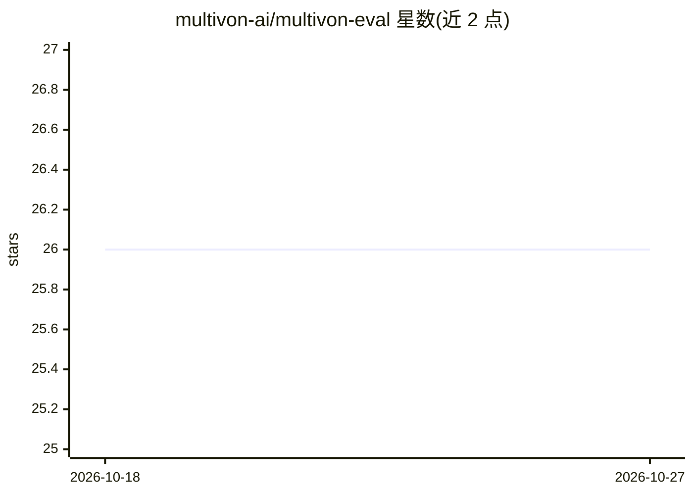

# multivon-ai/multivon-eval

⭐ 26 · Python · NOASSERTION · 推送 2026-09-21 · [GitHub](https://github.com/multivon-ai/multivon-eval) · [官网](https://multivon.ai) · 组织维护

**面向生产团队的 LLM 应用评测库：确定性检查+LLM 裁判**

Python 测试库，用于评测 LLM 应用、RAG 系统与 agent：定义任务用例、对输出打分、比较基线与提案变更，并将质量失败与错误、缺失证据分开处理。提供 7 大类 44 种评测器（ExactMatch、Faithfulness、Hallucination、ToolCallAccuracy 等），LLM 裁判可接 Anthropic/OpenAI/Google/Ollama/LiteLLM 等提供商，也可配置本地裁判。运行与报告本地留存，无需托管账户；提供 CLI 模板（RAG/agent/多轮对话）与 CI/CD 门禁（含回归阻断与 JUnit 输出）。当前版本 0.20.0，Apache 2.0，Python 3.10+。README 大量披露评测局限与负结果，不承诺 SoTA 或生产就绪。

## 筛选速览

| 维度 | 判定 | 备注 |
|---|---|---|
| AI 角色 | `ai-ecosystem` | LLM/agent 周边工具 |
| 许可风险 | `none` | NOASSERTION |
| 部署形态 | `library` | 以包/库形式分发 |
| 模型依赖 | local-ok | 支持本地模型 |
| 硬件要求 | — | 无带数字的原话,不猜 |
| 安装摩擦 | `low` | 无编译、无系统依赖或容器化 |
| 成熟度 | — | 结构信号不足 |

## 能力要点

- 44 种评测器分 7 类：确定性、LLM 裁判、agent 轨迹、会话、合规、多模态、一致性
- LLM 裁判支持 Anthropic/OpenAI/Google/Ollama/LiteLLM 及 OpenAI 兼容本地端点
- CI 门禁三级退出码：通过/质量未达标/证据不确定（错误、空运行、跳过覆盖）
- 基线与提案比较可阻断回归，报告输出 JSON/HTML/CSV/JUnit 本地留存

## 适用场景

- 在 CI 中对 LLM 应用与 RAG 系统做回归检测和质量门禁
- 用 LLM-as-judge 评估忠实度、幻觉与相关性，并校验裁判本身
- 评测 agent 工具调用准确性与任务完成情况
- 比较模型或提示词变更前后的表现并输出可移植报告

## 场景标签

`模型评测` · 领域:评测与运维

## 证据(README 行号)

> L10: multivon-eval is a Python library for testing LLM applications, RAG systems,
> L142: ## Evaluators — 44 across 7 tiers
> L159: ## Use it in CI

## 星数曲线

2026-10-18 26 → 2026-10-27 26（+0）

---
*卡片 v1 · prompt 1.4 · 生成 2026-10-26 · 置信度 high · 依据 README sha `897c91deb91e` · [字段定义](../../DATASET.md)*
