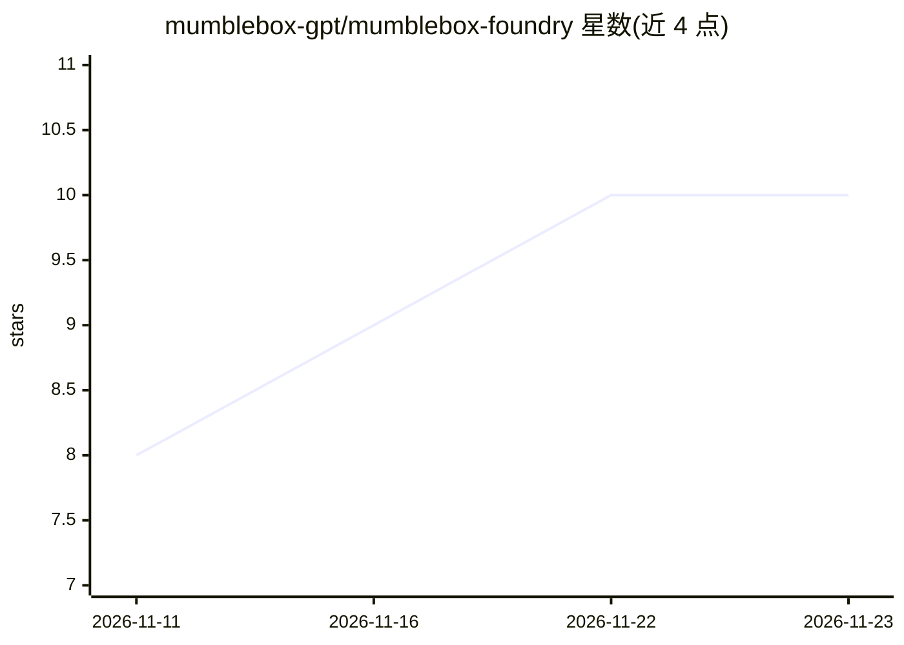

# mumblebox-gpt/mumblebox-foundry

⭐ 10 · Python · Apache-2.0 · 推送 2026-11-17 · [GitHub](https://github.com/mumblebox-gpt/mumblebox-foundry) · [官网](https://pinokio.co/apps/github-com-mumblebox-gpt-mumblebox-foundry) · 个人维护 · 中文 README

**本地 GPU 上的 AI 3D 资产生成与实验性自动绑骨工具，面向游戏/3D 创作者**

在本地 GPU 上通过引导式向导生成 3D 游戏资产：从单图或文本生成几何与纹理（Pixal3D、Hi3D、TRELLIS.2 等模型串联的 ComfyUI 工作流），导出 GLB/FBX/OBJ/STL 等格式供 Blender 使用；另有 TokenRig 本地 AI 自动绑骨与手动骨骼编辑向导。内置 MCP 服务让 Codex、Claude Code 等 agent 发现工作流、提交任务、检查预览并取回导出。通过 Pinokio 安装，当前为 Windows/NVIDIA 预览版，生成结果仍需人工检查与后续加工。

## 筛选速览

| 维度 | 判定 | 备注 |
|---|---|---|
| AI 角色 | `ai-native` | 本体是模型或模型工具 |
| 许可风险 | `permissive` | Apache-2.0 |
| 部署形态 | `None` |  |
| 模型依赖 | — | README 未给出锁定关系 |
| 硬件要求 | `gpu-8g` | |
| 安装摩擦 | `low` | 无编译、无系统依赖或容器化 |
| 成熟度 | `idea` | |

## 能力要点

- 11+ 种引导式生成工作流（图像/文本→带纹理 GLB，含 Gaussian splat 与照片测量路径）
- Rig a Character 向导：本地 AI（TokenRig）自动放置骨骼与学习权重，可手动修正并导出蒙皮 GLB
- 本地 MCP + 配套 skill 让编码 agent 调用工作流、获取空间证据（视角捕捉/深度探测/关节预览）
- 8 种界面语言，界面语言与生成提示语言分离

## 适用场景

- 用单张参考图生成带纹理的游戏道具或角色部件并导入 Blender
- 为静态网格自动生成骨架与权重后手动精修
- 让 Codex/Claude Code 等 agent 在 Blender 工作流前自动产出起始资产
- 生成发型卡片、服装粒子或 Gaussian splat 等特殊资产类型

## 场景标签

 · 领域:游戏/3D 内容创作

## 证据(README 行号)

> L7: **Make 3D gaming assets on your GPU, from quick blockouts to finished textured models for Blender.**
> L11: **Local AI auto-rigging with agent-driven refinement.** Open **Rig a Character** to fit a skeleton to a saved GLB. 
> L50: - **The MCP gives the agent tools.** Discover workflows and settings, submit jobs, follow progress, inspect preview
> L111: This is a **Windows / NVIDIA preview**. The reference machine has an RTX 4080 SUPER with 16 GB VRAM and 64 GB RAM.

## 星数曲线

2026-11-11 8 → 2026-11-23 10（+2）

---
*卡片 v1 · prompt 1.4 · 生成 2026-11-20 · 置信度 high · 依据 README sha `e5a8885c6a6c` · [字段定义](../../DATASET.md)*
