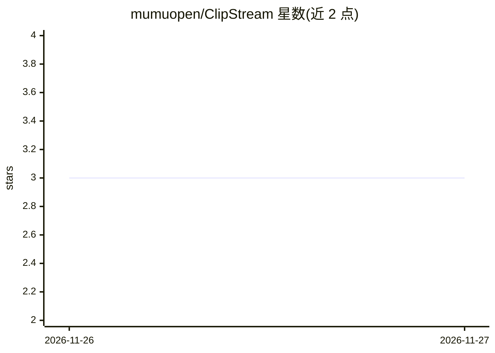

# mumuopen/ClipStream

⭐ — · [GitHub]() · 个人维护 · 中文 README

**无人值守直播切片流水线：自动录制高光切片并发布**

面向直播主的纯 Go 单二进制切片流水线：开播检测后分段录制（B站/虎牙），用 whisper 离线转写与弹幕密度峰值双信号挑选高光，FLV tag 级精准切片，LLM 翻译字幕与 edge-tts 配音，经三档审核闸门后匀速发布到多账号并推送战报。引擎（yt-dlp/ffmpeg/whisper/biliup）缺失时自动下载或降级：无 LLM 改弹幕热点直切，无 biliup 仅审核不出稿。

## 筛选速览

| 维度 | 判定 | 备注 |
|---|---|---|
| AI 角色 | `ai-native` | 本体是模型或模型工具 |
| 许可风险 | `permissive` | — |
| 部署形态 | `desktop` | 安装包/桌面程序 |
| 模型依赖 | — | README 未给出锁定关系 |
| 硬件要求 | — | 无带数字的原话,不猜 |
| 安装摩擦 | `medium` | 含编译或系统依赖之一 |
| 成熟度 | — | 结构信号不足 |

## 能力要点

- 弹幕密度 × whisper 转写双信号定位高光并切 20-60s 段落
- 引擎自动安装与优雅降级（缺 whisper/LLM/biliup 各有备用路径）
- 三档审核闸门与发布泵匀速调度，PushMe 战报推送
- B站/抖音网页扫码登录，零命令行配置

## 适用场景

- 游戏直播下播后自动产出高光切片并发布到 B站/抖音
- 服务器挂机无人值守运行录制-切片-发布全链路
- 为切片生成双语烧录字幕和 AI 配音

## 场景标签

 · 领域:直播/视频自动化工具

## 证据(README 行号)

> L19: 这就是 ClipStream 在做的事：**无人值守的直播切片工厂**。开播自动录，下播自动切，AI 只挑弹幕最热、解说最炸的段落，审核闸门挡住烂片，内容池在发布窗口内匀速发到绑定的账号，全程不需要人在电脑前。
> L29: |🎯|**双信号高光**|whisper 离线转写 × 弹幕互动峰值 → LLM 精选 20-60s 段落；无 LLM 时弹幕热点直切|
> L101: - **引擎全外挂 · 优雅降级**：缺 whisper → 跳过转写；缺 LLM → 弹幕热点直切；缺 biliup → 仅审核不出稿

## 星数曲线

2026-11-26 3 → 2026-11-27 3（+0）

---
*卡片 v1 · prompt 1.4 · 生成 2026-11-26 · 置信度 high · 依据 README sha `3f1640fae199` · [字段定义](../../DATASET.md)*
