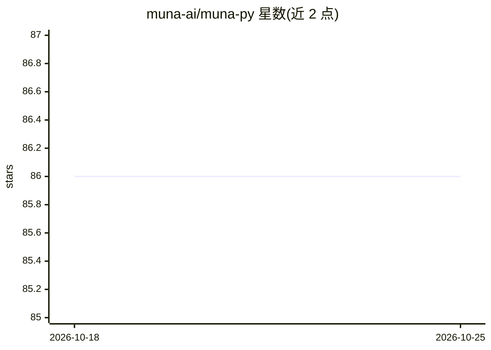

# muna-ai/muna-py

⭐ 86 · Python · Apache-2.0 · 推送 2026-10-23 · [GitHub](https://github.com/muna-ai/muna-py) · [官网](https://docs.muna.ai) · 组织维护

**本地与云端编译运行 AI 模型的 Python 客户端与 CLI**

Muna 的 Python 分发包，含 Python 客户端与命令行界面，通过 pip 安装。用户以访问密钥创建 Muna 客户端，采用 OpenAI 兼容接口形式调用模型（示例中运行 @openai/gpt-oss-20b 生成聊天补全并读取结果），宣称可在本地与云端编译并运行 AI 模型。需 Python 3.11+，由 NatML Inc. 维护，提供 Slack 社区、文档与博客链接。

## 筛选速览

| 维度 | 判定 | 备注 |
|---|---|---|
| AI 角色 | `ai-ecosystem` | LLM/agent 周边工具 |
| 许可风险 | `permissive` | Apache-2.0 |
| 部署形态 | `library` | 以包/库形式分发 |
| 模型依赖 | — | README 未给出锁定关系 |
| 硬件要求 | — | 无带数字的原话,不猜 |
| 安装摩擦 | `low` | 无编译、无系统依赖或容器化 |
| 成熟度 | — | 结构信号不足 |

## 能力要点

- 单包同时提供 Python 客户端与 CLI
- 通过访问密钥以 OpenAI 兼容接口调用模型
- 宣称支持本地与云端编译运行 AI 模型
- 要求 Python 3.11+

## 适用场景

- 在 Python 代码中调用 Muna 平台编译的 AI 模型
- 通过命令行界面运行模型
- 生成聊天补全并处理结果

## 场景标签

`推理引擎` · 领域:训练与推理

## 证据(README 行号)

> L5: Compile and run AI models locally & in the cloud.
> L8: Muna is distributed on PyPi. This distribution contains both the Python client and the command line interface (CLI).

## 星数曲线

2026-10-18 86 → 2026-10-25 86（+0）

---
*卡片 v1 · prompt 1.4 · 生成 2026-10-24 · 置信度 mid · 依据 README sha `5b375acdf0ee` · [字段定义](../../DATASET.md)*
