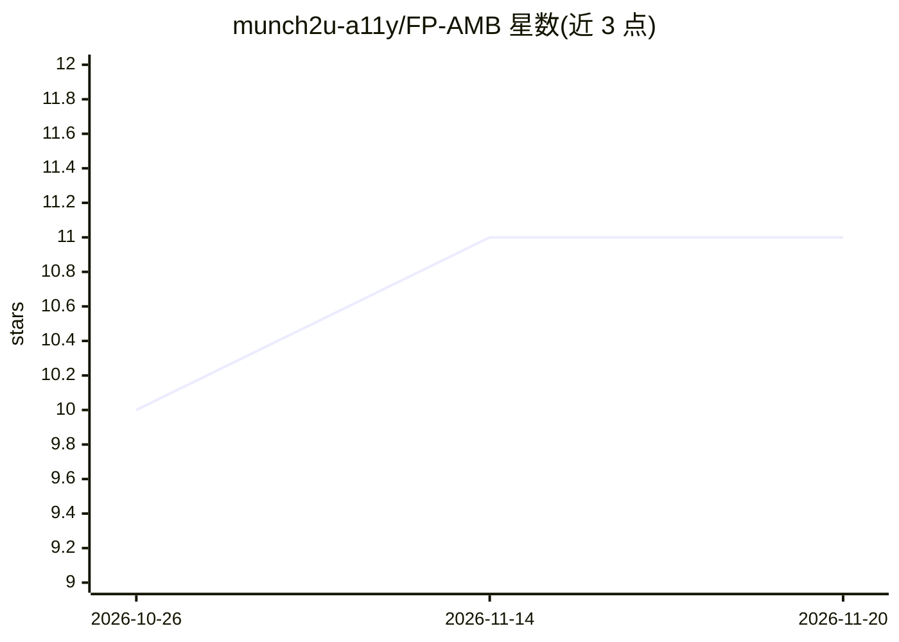

# munch2u-a11y/FP-AMB

⭐ 11 · Python · MIT · 推送 2026-08-27 · [GitHub](https://github.com/munch2u-a11y/FP-AMB) · 组织维护

**面向开发者的 AI Agent 长期记忆系统评测基准套件**

FP-AMB 是一个框架无关的长期记忆评测套件，针对 AI Agent 记忆系统，覆盖 10 个评测类别（事实回忆、多跳推理、时间推理、事实覆盖、说话者陷阱、拒答、来源可信度、工具使用），语料为 60 个会话、679 轮、约 51.3 万 token 的第一人称对话。通过 2 方法 SDK 接口（ingest_turn/retrieve_context）接入任意记忆系统，支持零 LLM 的纯检索评测与完整 LLM 生成评测两种模式，输出 JSON/HTML/Markdown 报告及失败根因分类报告。

## 筛选速览

| 维度 | 判定 | 备注 |
|---|---|---|
| AI 角色 | `ai-ecosystem` | LLM/agent 周边工具 |
| 许可风险 | `permissive` | MIT |
| 部署形态 | `library` | 以包/库形式分发 |
| 模型依赖 | local-ok | 支持本地模型 |
| 硬件要求 | — | 无带数字的原话,不猜 |
| 安装摩擦 | `low` | 无编译、无系统依赖或容器化 |
| 成熟度 | `idea` | |

## 能力要点

- 10 类评测 + 动态答案键绑定，262 题语料约 512,889 token、60 会话
- 2 方法 SDK 接口兼容任意 RAG/Graph/Agent 记忆系统
- 双评测模式：零 LLM 纯检索（<60s）与完整 LLM 生成检查
- 自动输出 HTML 仪表盘、Markdown 记分卡与失败根因分类报告

## 适用场景

- 开发自定义记忆引擎后用它跑基准并分析失败根因
- 对比不同检索架构在跨会话记忆任务上的表现
- 检测记忆系统对虚假前提、事实覆盖与拒答场景的鲁棒性

## 场景标签

`模型评测` `Agent 记忆` · 领域:Agent 开发

## 证据(README 行号)

> L7: **FP-AMB (First-Person Agent Memory Benchmark)** is an industry-standard, framework-agnostic evaluation suite engine
> L17: - **Framework Agnostic**: Simple 2-method SDK interface (`ingest_turn` and `retrieve_context`) compatible with any 
> L21: - **Dual Evaluation Modes**: Supports ultra-fast pure retrieval evaluation (zero-LLM latency, <60s) as well as full

## 星数曲线

2026-10-26 10 → 2026-11-20 11（+1）

---
*卡片 v1 · prompt 1.4 · 生成 2026-11-18 · 置信度 high · 依据 README sha `9ecc6d4caf7b` · [字段定义](../../DATASET.md)*
