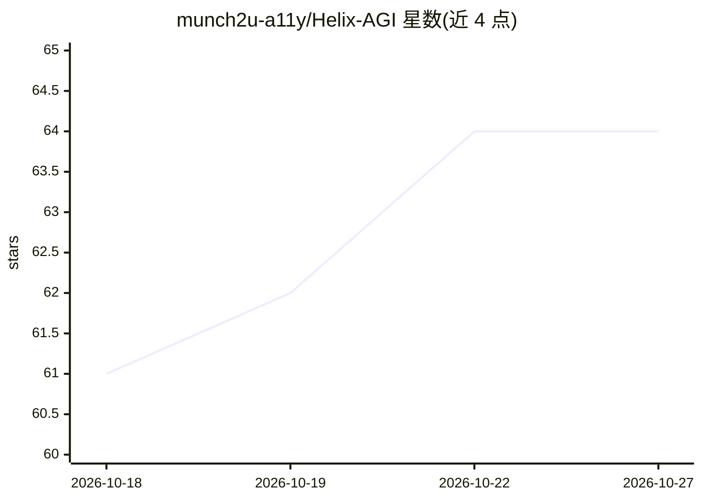

# munch2u-a11y/Helix-AGI

⭐ 64 · Python · Apache-2.0 · 推送 2026-10-21 · [GitHub](https://github.com/munch2u-a11y/Helix-AGI) · 个人维护

**本地双 RWKV 自主智能体：持续感知、私有思考与直接说话**

在本地持续运行 sense-think-act-communicate 循环的 agent 系统：以文件系统为家，后台传感器观察房间内文件与变化，动作经数字身体以 motor 信号执行（移动/打开/运行沙箱化 Python），私有思考与对外说话分离，无需 SPEAK 命令或工具调用 JSON。面向想在本地运行具持续记忆与环境感知 agent 的开发者；需 Python 3.11+、Linux Bubblewrap、Ollama、MightyMem 源码与 RWKV checkpoint，当前原生桥接跑在 CPU 上；自主连贯说话与独立任务能力尚未验证。

## 筛选速览

| 维度 | 判定 | 备注 |
|---|---|---|
| AI 角色 | `ai-native` | 本体是模型或模型工具 |
| 许可风险 | `permissive` | Apache-2.0 |
| 部署形态 | `library` | 以包/库形式分发 |
| 模型依赖 | local-ok | 支持本地模型 |
| 硬件要求 | `cpu-ok` | |
| 安装摩擦 | `low` | 无编译、无系统依赖或容器化 |
| 成熟度 | `idea` | |

## 能力要点

- 持续后台感知：语言生成与脚本执行期间文件系统观察不停
- 私有思考与普通语言直接说话分离，无动作 JSON 输出
- workshop 沙箱内运行 Python 实验，执行前校验脚本哈希
- 命名房间、个人文件与记忆跨优雅关机/重启持久化

## 适用场景

- 在本地运行一个有持久家目录与记忆的常驻 agent
- 让 agent 在沙箱中打开并运行 Python 实验并读回结果
- 通过 Dashboard 观察环境、文件内容与身体状态并下达指令

## 场景标签

`Agent 框架` · 领域:Agent 开发

## 证据(README 行号)

> L3: **A local Dual RWKV agent with continuous senses, a working digital body,
> L6: Helix runs an ongoing loop of sensing, thinking, acting and communicating.
> L9: Private thought and outward speech have separate routes, so speaking requires

## 星数曲线

2026-10-18 61 → 2026-10-27 64（+3）

---
*卡片 v1 · prompt 1.4 · 生成 2026-10-24 · 置信度 high · 依据 README sha `50e8d8958add` · [字段定义](../../DATASET.md)*
