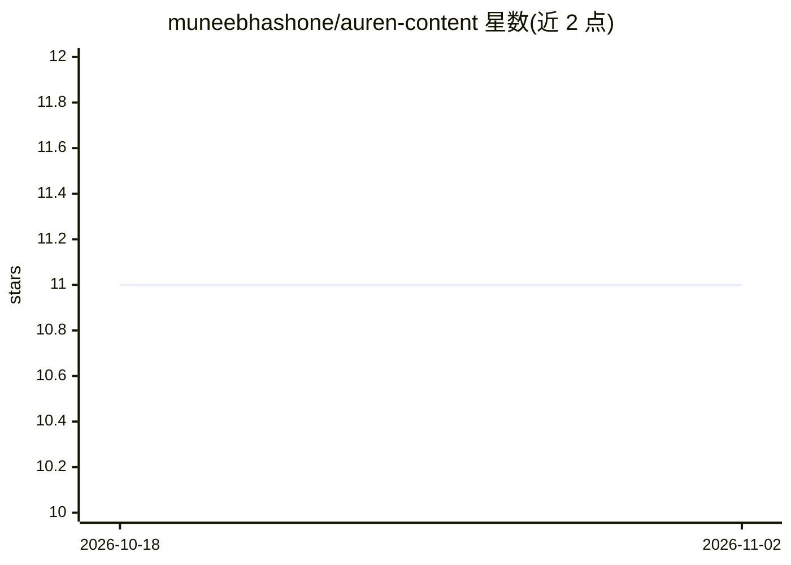

# muneebhashone/auren-content

⭐ 11 · TypeScript · MIT · 推送 2026-08-25 · [GitHub](https://github.com/muneebhashone/auren-content) · 个人维护

**面向创始人/小团队的多 LLM 内容策略仪表盘，生成周度社媒日历**

单用户内容操作系统：配置业务画像（ICP、目标、人设、故事库）与周简报后，运行流水线——调研（趋势/竞品/新闻）、分析历史帖表现、规划混合内容日历、经草稿→hook 评审→润色的多步 LLM 链撰写各时段内容，在日历/看板上审阅导出；另有 Rewrite 模式将原始素材生成 LinkedIn/X/Reddit 六种变体。模型经自部署的 AI API Gateway 按任务路由（默认 Perplexity Sonar Pro、Claude、GPT 系列），可选图片生成。基于 Next.js + Drizzle/SQLite，需 Bun 或 Node 20+ 运行。

## 筛选速览

| 维度 | 判定 | 备注 |
|---|---|---|
| AI 角色 | `ai-native` | 本体是模型或模型工具 |
| 许可风险 | `permissive` | MIT |
| 部署形态 | `None` |  |
| 模型依赖 | — | README 未给出锁定关系 |
| 硬件要求 | — | 无带数字的原话,不猜 |
| 安装摩擦 | `low` | 无编译、无系统依赖或容器化 |
| 成熟度 | — | 结构信号不足 |

## 能力要点

- 调研→表现摘要→策略规划→并行写作的流水线作业
- 按任务配置模型路由（研究/策略/写作/hook 评审等各用不同模型）
- Rewrite 模式：一次脑暴生成 6 个平台变体（3 平台×润色/忠实）
- 帖子带结构化 rationale 与可选引用，支持指标回灌下次生成

## 适用场景

- 我一个人维护多个社媒账号的周内容排期
- 把零散想法转成各平台原生的帖子草稿
- 基于历史表现数据迭代下周内容策略

## 场景标签

 · 领域:内容营销/社媒管理

## 证据(README 行号)

> L49: Auren is a single-user **content operating system** for founders and small teams who publish under multiple voices.
> L54: 4. **Writes each slot** through a multi-step LLM chain: draft → hook critic → polish → rationale

## 星数曲线

2026-10-18 11 → 2026-11-02 11（+0）

---
*卡片 v1 · prompt 1.4 · 生成 2026-11-02 · 置信度 high · 依据 README sha `0069b86464b8` · [字段定义](../../DATASET.md)*
