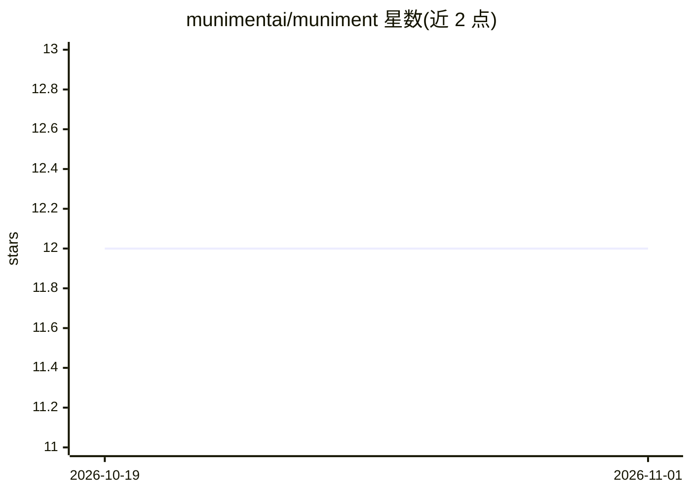

# munimentai/muniment

⭐ 12 · Rust · NOASSERTION · 推送 2026-10-31 · [GitHub](https://github.com/munimentai/muniment) · [官网](https://muniment.ai) · 组织维护

**整合多种模型、工具与文件的免费桌面工作台**

基于 Tauri 的桌面应用：接入 provider 账户、API key 或本地模型，可手动选模型或由内置的 Jev 路由每个请求，并显示各订阅窗口剩余用量。工作区聚合项目、线程、文件、终端与浏览器；支持添加 MCP server、技能与插件，提供六种权限模式、定时/Webhook/工具检查触发的 agent、跨机器配对运行线程，以及跨线程记忆与端侧语音听写。提供 macOS/Windows/Linux 安装包；源码采用 FSL-1.1-ALv2 许可，两年后转为 Apache 2.0，不接受外部代码贡献。

## 筛选速览

| 维度 | 判定 | 备注 |
|---|---|---|
| AI 角色 | `ai-ecosystem` | LLM/agent 周边工具 |
| 许可风险 | `none` | NOASSERTION |
| 部署形态 | `desktop` | 安装包/桌面程序 |
| 模型依赖 | — | README 未给出锁定关系 |
| 硬件要求 | — | 无带数字的原话,不猜 |
| 安装摩擦 | `low` | 无编译、无系统依赖或容器化 |
| 成熟度 | — | 结构信号不足 |

## 能力要点

- 多 provider/本地模型接入与 Jev 自动路由，显示订阅窗口剩余用量
- MCP server、技能、插件扩展，六种权限模式
- agent 支持定时、Webhook、工具检查触发，可跨桌面/服务器/容器运行
- 跨线程记忆（含来源）与端侧语音听写

## 适用场景

- 在一个桌面应用里统一使用多家模型和本地模型
- 搭建带工具、文件、终端和浏览器的项目工作区
- 定时或事件触发 agent 在配对的远程机器上运行

## 场景标签

`AI 助手` · 领域:对话与助手

## 证据(README 行号)

> L22: - **Your models, together.** Connect provider accounts, API keys, or local models. Choose a model or let Jev route 
> L24: - **Tools that fit your work.** Add MCP servers, skills, and plugins. Pick extra ones for a single turn.

## 星数曲线

2026-10-19 12 → 2026-11-01 12（+0）

---
*卡片 v1 · prompt 1.4 · 生成 2026-11-01 · 置信度 high · 依据 README sha `12f2109f4502` · [字段定义](../../DATASET.md)*
