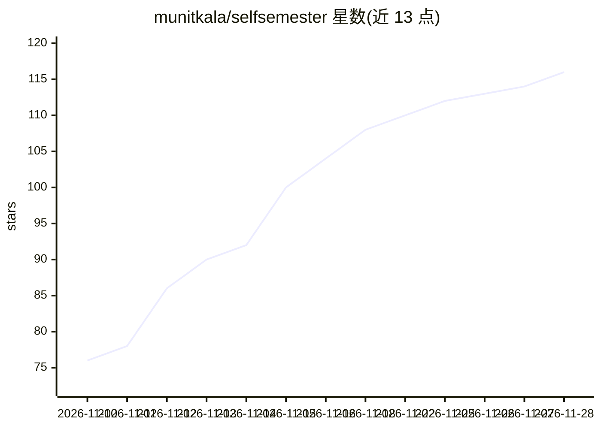

# munitkala/selfsemester

⭐ 116 · Rust · MIT · 推送 2026-11-25 · [GitHub](https://github.com/munitkala/selfsemester) · 个人维护

**把任何学科变成按日程授课打分的桌面大学式课程**

面向 Windows 与 Linux 的桌面应用：用户给出学科，AI 先询问目标与水平并给出可行性报告，批准后一次性写出完整课程（讲义、作业、测验、考试），随后按日程逐日发布、强制截止日期、按评分标准自动批改测验与手写作业，成绩记入成绩单。默认通过用户自己的 Claude Code 订阅运行，也可配置任意 OpenAI 风格、Anthropic、Gemini、Ollama 等 API、自定义 HTTP 请求或本机命令行程序承担各环节工作。课程构建需联网且消耗较大配额，阅读与做题可离线。

## 筛选速览

| 维度 | 判定 | 备注 |
|---|---|---|
| AI 角色 | `ai-native` | 本体是模型或模型工具 |
| 许可风险 | `permissive` | MIT |
| 部署形态 | `desktop` | 安装包/桌面程序 |
| 模型依赖 | local-ok | 支持本地模型 |
| 硬件要求 | — | 无带数字的原话,不猜 |
| 安装摩擦 | `medium` | 含编译或系统依赖之一 |
| 成熟度 | `idea` | |

## 能力要点

- 课程构建前输出 readiness report 与分档构建级别（Quick 到 Maximum）
- 支持任一环节指定不同 AI 服务，含自定义 HTTP 请求与本机命令行程序
- LaTeX 数学、精确绘制的图表与课内沙盒化 Python 代码运行
- 答案与未发布试卷在本地加密存放，所有数据保留在用户计算机上

## 适用场景

- 自学一门学科并获得带截止日期与成绩的完整课程
- 把已有 PDF/讲义/幻灯片转成结构化课程
- 按课程标准或考试大纲逐条对照编写与检查课程
- 用本地模型承担写作任务以减少云端调用

## 场景标签

 · 领域:教育/课程生成

## 证据(README 行号)

> L5: A desktop app for Windows and Linux that turns any subject into a full university-style course: lessons, homework,
> L49: - **Your choice of AI**: Claude Code with your subscription by default, or any other service for any of the jobs:
> L15: And if you'd rather not use Claude Code, or only want it for some of the work, you can use **any other AI service**

## 星数曲线

2026-11-10 76 → 2026-11-28 116（+40）

---
*卡片 v1 · prompt 1.4 · 生成 2026-11-28 · 置信度 mid · 依据 README sha `aa2c81622646` · [字段定义](../../DATASET.md)*
