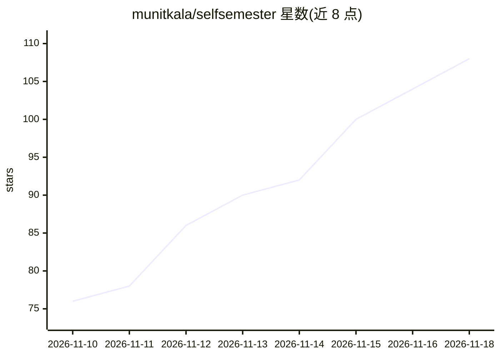

# munitkala/selfsemester

⭐ 108 · Rust · MIT · 推送 2026-11-16 · [GitHub](https://github.com/munitkala/selfsemester) · 个人维护

**把任意科目变成可排期、可打分课程的 Windows 自学应用**

Windows 桌面应用，面向个人自学者：用户指定科目后，由用户已登录的 Claude Code 询问目标与水平、生成教学大纲与就绪度报告，经确认后一次性写出含 LaTeX 数学、精确图表的完整课程；应用随后按日发布材料、执行截止期限、自动批改测验，并将书面与手写作业交回 Claude 按评分细则打分，成绩记入成绩单。也可在课程构建器中完全不用 Claude 自行编写课程。所有数据留在本地，无服务器与账户系统。版本 0.7.1，自述为早期阶段。

## 筛选速览

| 维度 | 判定 | 备注 |
|---|---|---|
| AI 角色 | `ai-native` | 本体是模型或模型工具 |
| 许可风险 | `permissive` | MIT |
| 部署形态 | `desktop` | 安装包/桌面程序 |
| 模型依赖 | locked-api |  |
| 硬件要求 | — | 无带数字的原话,不猜 |
| 安装摩擦 | `low` | 无编译、无系统依赖或容器化 |
| 成熟度 | `idea` | |

## 能力要点

- Claude 生成完整课程并按评分细则批改书面与手写作业
- 按日程发布材料、强制截止期限、成绩记入成绩单
- 课程构建器支持完全不用 Claude 自行编写课程
- 数据全部留在本地，无服务器与账户系统

## 适用场景

- 把感兴趣的科目变成有截止期限和成绩的自学课程
- 用手机拍照提交手写作业获得 AI 批改
- 基于已有 PDF/文档自建课程并同样排期打分

## 场景标签

`AI 写作` · 领域:内容生成

## 证据(README 行号)

> L5: A Windows desktop app that turns any subject into a full university-style course: lessons, homework, quizzes,
> L8: You name a subject. Claude asks a few questions about your goals and level, plans a syllabus, and tells you how well
> L11: its own: it releases material day by day, enforces deadlines, auto-marks quizzes, and sends written work and photos

## 星数曲线

2026-11-10 76 → 2026-11-18 108（+32）

---
*卡片 v1 · prompt 1.4 · 生成 2026-11-17 · 置信度 high · 依据 README sha `7aa1f132fd68` · [字段定义](../../DATASET.md)*
