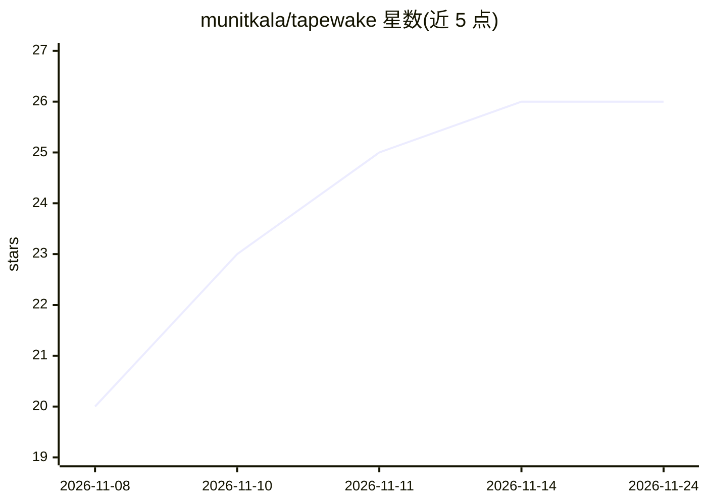

# munitkala/tapewake

⭐ 26 · HTML · MIT · 推送 2026-11-08 · [GitHub](https://github.com/munitkala/tapewake) · 个人维护

**本地修复老 VHS/家庭录像的桌面应用：去隔行+AI 超分+人脸与声音修复**

面向个人用户的 Windows/macOS 桌面应用，在本地电脑上修复 VHS 等旧家庭录像：QTGMC 去隔行、Real-ESRGAN AI 超分至 1280×960、CodeFormer/DicFace 人脸修复、Demucs/DeepFilterNet 声音修复，全程不上传。支持隔行 NTSC 与逐行视频两种已测试模式，可断点续跑、过热自动暂停。限制：尚无安装包、需手动配置环境与外部工具；每小时录像峰值约需 50GB 磁盘；人脸模型仅限非商业用途；PAL 隔行视频暂不支持。

## 筛选速览

| 维度 | 判定 | 备注 |
|---|---|---|
| AI 角色 | `ai-native` | 本体是模型或模型工具 |
| 许可风险 | `permissive` | MIT |
| 部署形态 | `None` |  |
| 模型依赖 | — | README 未给出锁定关系 |
| 硬件要求 | — | 无带数字的原话,不猜 |
| 安装摩擦 | `medium` | 含编译或系统依赖之一 |
| 成熟度 | `idea` | |

## 能力要点

- QTGMC 去隔行 + Real-ESRGAN 超分至 1280×960/59.94fps 的完整修复流水线
- 人脸修复（CodeFormer/DicFace/KEEP）与声音修复（Demucs/DeepFilterNet/Resemble Enhance）可开关
- 分片处理可暂停续跑，过热自动暂停；原始文件不被修改
- AMD/Intel 显卡经 DirectML 也可运行超分（0.2.1 起）

## 适用场景

- 把家里的 VHS 婚礼录像带数字化并修复画质
- 修复 DVD/蓝光 rip 等逐行视频并放大两倍
- 清理旧录像中的人声与背景噪音

## 场景标签

`图像视频处理` · 领域:感知与多模态

## 证据(README 行号)

> L10: tapewake restores old VHS and home videos on your own computer: it deinterlaces the tape, upscales it with AI,
> L31:  deinterlacing, Real-ESRGAN upscaling to 1280×960 at 59.94 fps, face restoration that keeps likeness, gentle grain,

## 星数曲线

2026-11-08 20 → 2026-11-24 26（+6）

---
*卡片 v1 · prompt 1.4 · 生成 2026-11-18 · 置信度 high · 依据 README sha `44ab61f6bf73` · [字段定义](../../DATASET.md)*
