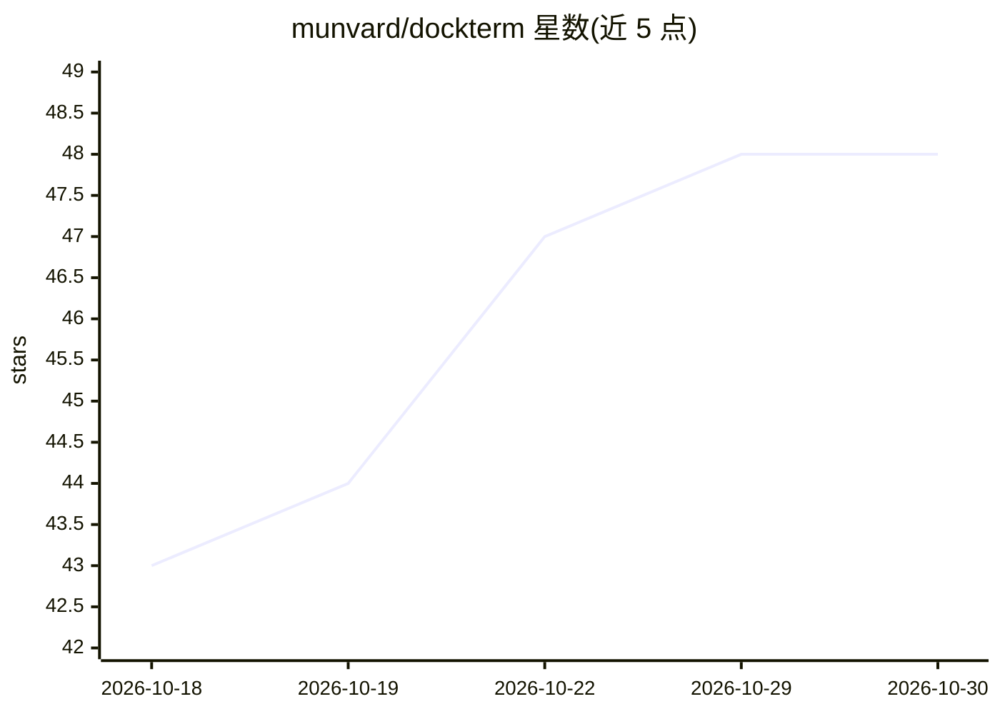

# munvard/dockterm

⭐ 48 · TypeScript · MIT · 推送 2026-10-13 · [GitHub](https://github.com/munvard/dockterm) · [官网](https://munetic.net/dockterm) · 个人维护 · 中文 README

**给开发者的 Claude Code 终端工作区，含凹槽提示吉祥物**

基于 Electron 的终端优先工作区，围绕真实 claude CLI 会话构建：多窗格终端（原生 PTY + xterm.js）、会话检查点、子代理活动面板、diff 审查与 Git 提交、文件树与 Monaco 编辑器、MCP/skills 只读视图、Claude 用量额度面板。特色 munu 吉祥物从终端输出推断 Claude 状态，在全屏应用上浮出权限提示供一键作答。本产品自身不调用任何 AI、无账号无遥测，macOS/Windows/Linux 提供 MIT 开源下载。

## 筛选速览

| 维度 | 判定 | 备注 |
|---|---|---|
| AI 角色 | `ai-ecosystem` | LLM/agent 周边工具 |
| 许可风险 | `permissive` | MIT |
| 部署形态 | `desktop` | 安装包/桌面程序 |
| 模型依赖 | — | README 未给出锁定关系 |
| 硬件要求 | — | 无带数字的原话,不猜 |
| 安装摩擦 | `low` | 无编译、无系统依赖或容器化 |
| 成熟度 | — | 结构信号不足 |

## 能力要点

- munu 凹槽吉祥物读取 Claude 状态并在全屏应用上浮出权限提示
- 保留真实 claude 会话的检查点轨道与子代理实时活动面板
- diff 审查、安全 Git 提交与 200k 文件级 Quick Open/全文搜索
- Claude 5 小时/每周真实用量的实时显示与重置倒计时

## 适用场景

- 让 Claude Code 跑着、自己去干别的，等提示来了从凹槽一键作答
- 在一个窗口里并排跑多个仓库的 Claude 会话并审查 diff 后提交
- 实时查看 Claude 用量额度还剩多少、何时重置

## 场景标签

 · 领域:开发者工具/AI 编程工作区

## 证据(README 行号)

> L6:  A terminal-first workspace for Claude Code. Keep your real <code>claude</code> session, with checkpoints, live agen
> L52: - 🔒 **Local-only**: no accounts, no telemetry; it never calls an AI of its own.
> L77: DockTerm reads Claude's state from the terminal output and shows it as **munu**, a small face near your menu bar (i

## 星数曲线

2026-10-18 43 → 2026-10-30 48（+5）

---
*卡片 v1 · prompt 1.4 · 生成 2026-10-25 · 置信度 mid · 依据 README sha `398c3729624a` · [字段定义](../../DATASET.md)*
