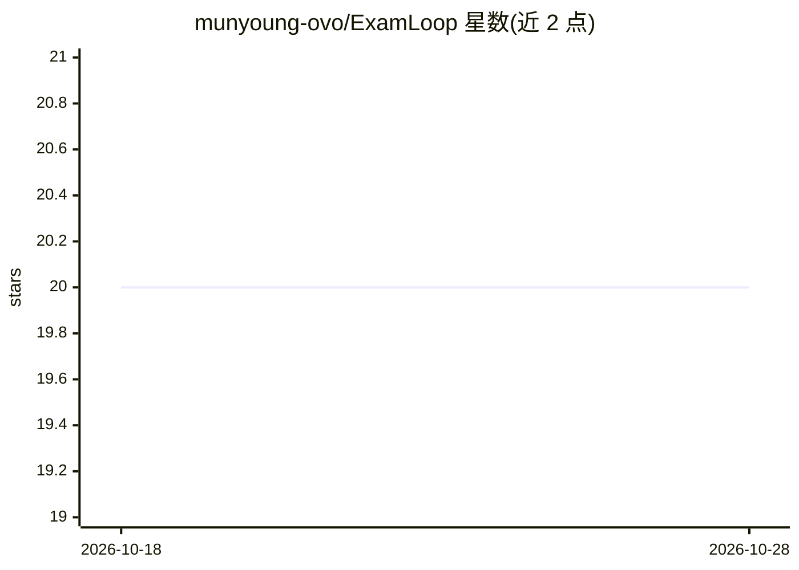

# munyoung-ovo/ExamLoop

⭐ 20 · HTML · MIT · 推送 2026-06-09 · [GitHub](https://github.com/munyoung-ovo/ExamLoop) · 个人维护 · 中文 README

**跑在 Claude Code 上的期末冲刺技能：速通/出题/解题/出卷**

面向期末备考用户的 Claude Code Skill：安装后在 Claude Code 中载入 examloop，可从上传的 PPT/PDF 提取考点与答题模板、按指定考点和难度出题并自动批改、粘贴题目按学科框架讲解、生成完整试卷 HTML 文件，覆盖理科文科医学法学工科。提供 npx 一行安装，也支持 git clone、ZIP 与手动复制 SKILL.md 到 .claude/skills 目录（Windows 建议用 npx 方式）。更新通过 git pull 或 bash update.sh 完成。

## 筛选速览

| 维度 | 判定 | 备注 |
|---|---|---|
| AI 角色 | `ai-native` | 本体是模型或模型工具 |
| 许可风险 | `permissive` | MIT |
| 部署形态 | `library` | 以包/库形式分发 |
| 模型依赖 | — | README 未给出锁定关系 |
| 硬件要求 | — | 无带数字的原话,不猜 |
| 安装摩擦 | `low` | 无编译、无系统依赖或容器化 |
| 成熟度 | — | 结构信号不足 |

## 能力要点

- PPT/PDF 资料速通：自动提取考点与答题模板
- 按考点与难度出题并自动批改
- 粘贴题目分学科框架讲解
- 生成完整试卷 HTML 文件

## 适用场景

- 期末前一周把整本书的考点梳理成体系
- 针对薄弱考点生成练习题并自动批改
- 生成模拟试卷进行自测

## 场景标签

`文档问答` · 领域:知识与检索

## 证据(README 行号)

> L9: 跑在 Claude Code 上的期末冲刺工具
> L14: - 资料速通 — 上传PPT/PDF，自动提取考点和答题模板

## 星数曲线

2026-10-18 20 → 2026-10-28 20（+0）

---
*卡片 v1 · prompt 1.4 · 生成 2026-10-28 · 置信度 high · 依据 README sha `5f48fec08c45` · [字段定义](../../DATASET.md)*
