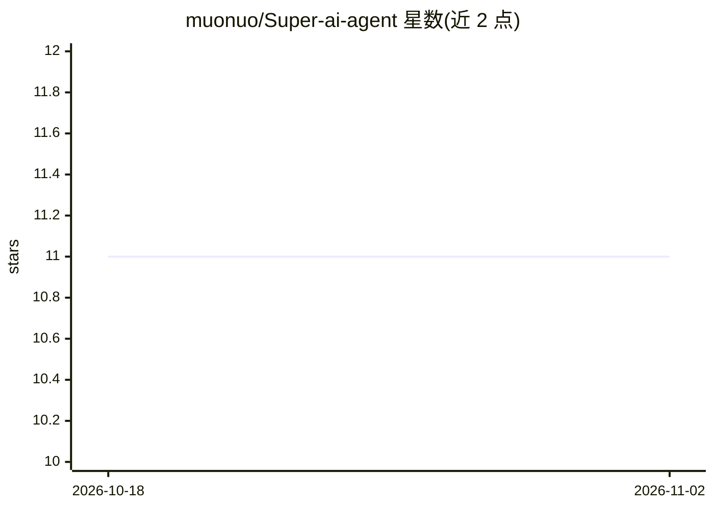

# muonuo/Super-ai-agent

⭐ 11 · Java · Apache-2.0 · 推送 2026-05-28 · [GitHub](https://github.com/muonuo/Super-ai-agent) · 个人维护 · 中文 README

**Spring Boot + Vue 的 AI 对话平台：情感咨询助手与深度思考智能体**

基于 Spring Boot 3.5、Java 21、Spring AI 与 Vue 3 的全栈 AI 对话平台，包含两个应用：AI 恋爱大师（基础/智能/RAG 三种对话模式、恋爱报告生成）与 AI 超级智能体（ReAct 循环、思考过程展示、14+ 工具调用、MCP 协议集成高德 15 个地图工具、无限循环检测）。模型接入阿里云通义千问与 DashScope 嵌入，Ollama 为可选本地部署，向量存储用 PGVector。README 定位为学习与简历项目，提供 Docker Compose 与手动搭建两种启动方式，需 MySQL、PostgreSQL 与 DashScope API Key。

## 筛选速览

| 维度 | 判定 | 备注 |
|---|---|---|
| AI 角色 | `ai-native` | 本体是模型或模型工具 |
| 许可风险 | `permissive` | Apache-2.0 |
| 部署形态 | `self-host` | docker 或自建部署 |
| 模型依赖 | local-ok | 支持本地模型 |
| 硬件要求 | — | 无带数字的原话,不猜 |
| 安装摩擦 | `low` | 无编译、无系统依赖或容器化 |
| 成熟度 | — | 结构信号不足 |

## 能力要点

- ReAct 循环（思考-行动-观察）与思考过程可视化
- 14+ 自动工具调用（搜索/文件/邮件/PDF 等）+ MCP 协议集成高德 15 个地图工具
- RAG 知识库检索（PGVector、多查询扩展、失败自动回退）
- 问题分类：简单问题直答，复杂问题深度思考

## 适用场景

- 学习用 Spring AI 构建完整智能体应用
- 搭建情感咨询对话助手并生成结构化报告
- 体验带工具调用与思考过程展示的通用智能体

## 场景标签

 · 领域:AI 应用开发/智能体

## 证据(README 行号)

> L62: Super AI Agent is a **production-grade AI conversational platform** that demonstrates how to build a complete intel
> L156: |Chat Model|Alibaba Cloud Tongyi Qianwen|qwen-max, qwen-plus|
> L90: |📚 **Beginner Friendly**|Detailed code comments, clean architecture, great for Spring AI beginners|

## 星数曲线

2026-10-18 11 → 2026-11-02 11（+0）

---
*卡片 v1 · prompt 1.4 · 生成 2026-11-02 · 置信度 high · 依据 README sha `e2ea5de413b7` · [字段定义](../../DATASET.md)*
