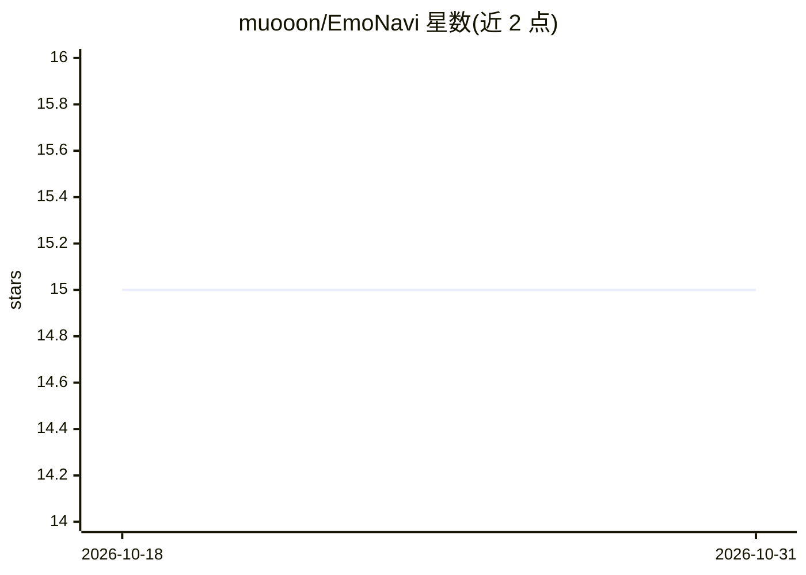

# muooon/EmoNavi

⭐ 15 · Python · Apache-2.0 · 推送 2026-01-30 · [GitHub](https://github.com/muooon/EmoNavi) · 个人维护

**深度学习训练用"情感驱动"自适应优化器（EmoNavi/Fact/Lynx）**

面向深度学习训练的自适应优化器系列：以 EmoNavi（Adam 型）为主，附带 EmoFact（Adafactor 型）与 EmoLynx（Lion 型）三个变体。核心机制为 emoDrive 混合学习率：以用户指定学习率为中心自动加减速，通过 multi-EMA 与 tanh 标量化的"情感机制"捕捉 loss 变化，近似高阶矩（三/四/五次）效果，附加自我修复、动态调度器、自动停止、分布式免同步等功能，无需额外张量。README 声明 v3.6 为开发终了版，建议迁移到 EmoSens 世代。代码托管于 Hugging Face，附带英文论文 txt 文件。

## 筛选速览

| 维度 | 判定 | 备注 |
|---|---|---|
| AI 角色 | `ai-ecosystem` | LLM/agent 周边工具 |
| 许可风险 | `permissive` | Apache-2.0 |
| 部署形态 | `None` |  |
| 模型依赖 | — | README 未给出锁定关系 |
| 硬件要求 | — | 无带数字的原话,不猜 |
| 安装摩擦 | `low` | 无编译、无系统依赖或容器化 |
| 成熟度 | — | 结构信号不足 |

## 能力要点

- emoDrive 混合学习率：以用户指定 LR 为中心自动加减速
- 三个变体：EmoNavi（Adam 型）、EmoFact（Adafactor 型）、EmoLynx（Lion 型）
- 近似高阶矩效果，无需额外张量、声明计算开销可忽略
- 支持再开/积层/非同步分布式学习且免同步、免交接

## 适用场景

- 在深度学习训练中替换现有优化器以获得自动学习率调节
- 分布式或持续学习场景中免同步、免交接地恢复训练
- 为不同显存/精度需求在 EmoNavi/Fact/Lynx 间选择变体

## 场景标签

 · 领域:深度学习/优化器

## 证据(README 行号)

> L98: ### あなたの望む最適化 EmoNavi が叶えます
> L101: ###### **感情で学習をナビゲートする｢感情型オプティマイザ｣** です
> L104: ###### **It’s an “Emotional Optimizer” that navigates learning through feeling.**

## 星数曲线

2026-10-18 15 → 2026-10-31 15（+0）

---
*卡片 v1 · prompt 1.4 · 生成 2026-10-30 · 置信度 high · 依据 README sha `cd5ff428c463` · [字段定义](../../DATASET.md)*
