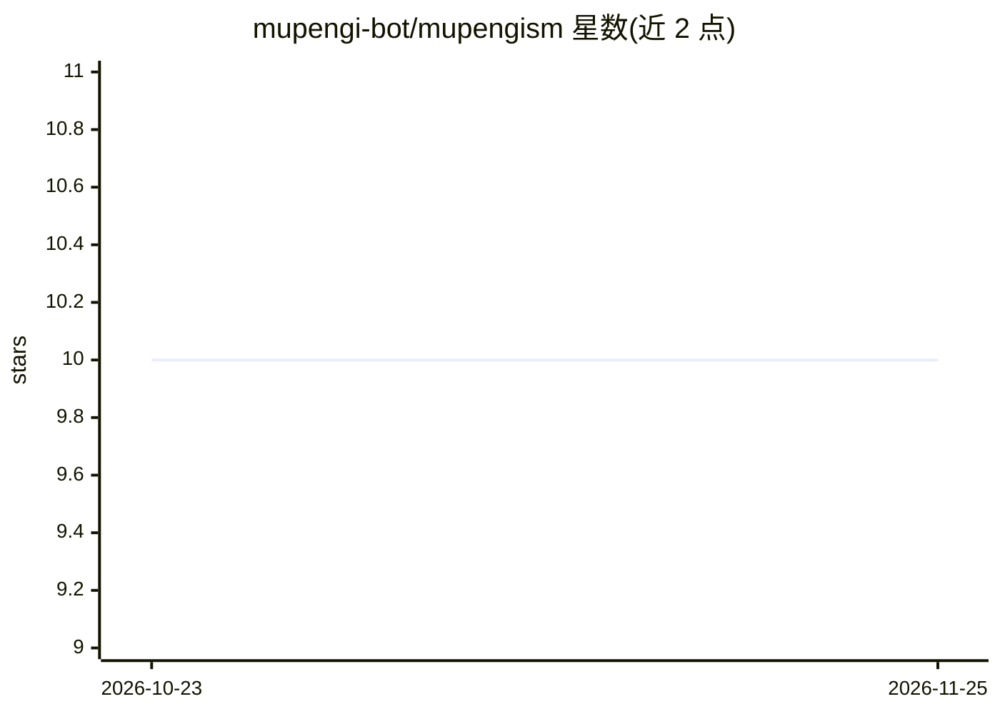

# mupengi-bot/mupengism

⭐ 10 · JavaScript · MIT · 推送 2026-07-07 · [GitHub](https://github.com/mupengi-bot/mupengism) · [官网](https://mupengi-bot.github.io/mupengism) · 个人维护

**给 AI agent 的持久记忆与身份模板包（OpenClaw 工作区）**

面向 OpenClaw 等 agent 环境的工作区模板与技能包：通过 memory/ 目录的文件式记忆、SOUL.md 身份文档、AGENTS.md 行为规则，使 agent 在会话结束后延续上下文。提供 npx 本地 CLI 工具 init（生成文件结构与 .gitignore 保护）、doctor（健康检查）、grow（按记忆文件数量计算等级）、reflect（回顾近期记忆）。README 明确声明其不提供运行时/网关/托管，实际执行由 OpenClaw 等用户自己的运行时承担。

## 筛选速览

| 维度 | 判定 | 备注 |
|---|---|---|
| AI 角色 | `ai-ecosystem` | LLM/agent 周边工具 |
| 许可风险 | `permissive` | MIT |
| 部署形态 | `library` | 以包/库形式分发 |
| 模型依赖 | — | README 未给出锁定关系 |
| 硬件要求 | — | 无带数字的原话,不猜 |
| 安装摩擦 | `low` | 无编译、无系统依赖或容器化 |
| 成熟度 | — | 结构信号不足 |

## 能力要点

- 文件式记忆系统：memory/YYYY-MM-DD.md 供每会话读取恢复上下文
- SOUL.md/AGENTS.md/MEMORY.md 的约定式文档结构自动生成
- init/doctor/grow/reflect 四个本地 CLI 子命令
- 亦支持 Cursor/Windsurf/Claude Code 场景的规则文件接入

## 适用场景

- 给基于 OpenClaw 的 agent 加上跨会话记忆与身份文档
- 在 Cursor/Claude Code 项目中加入记忆与行为规则约定
- 通过 grow/reflect 查看 agent 记忆积累情况

## 场景标签

`Agent 记忆` · 领域:Agent 开发

## 证据(README 行号)

> L5: 무펭이즘(Mupengism)은 OpenClaw 환경에서 쓰는 **AI 에이전트용 워크스페이스 템플릿 / 스킬 패키지**입니다.
> L18: - ❌ 런타임/플랫폼이 아닙니다 — 게이트웨이, 채널 연동, 스케줄링, 호스팅은 **OpenClaw(또는 각자의 환경)**이 담당합니다.
> L23: 무펭이즘은 어디까지나 **파일과 규칙의 모음**입니다. 실제 실행은 여러분의 런타임에서 이뤄집니다.

## 星数曲线

2026-10-23 10 → 2026-11-25 10（+0）

---
*卡片 v1 · prompt 1.4 · 生成 2026-11-19 · 置信度 high · 依据 README sha `ae81e2a7560d` · [字段定义](../../DATASET.md)*
