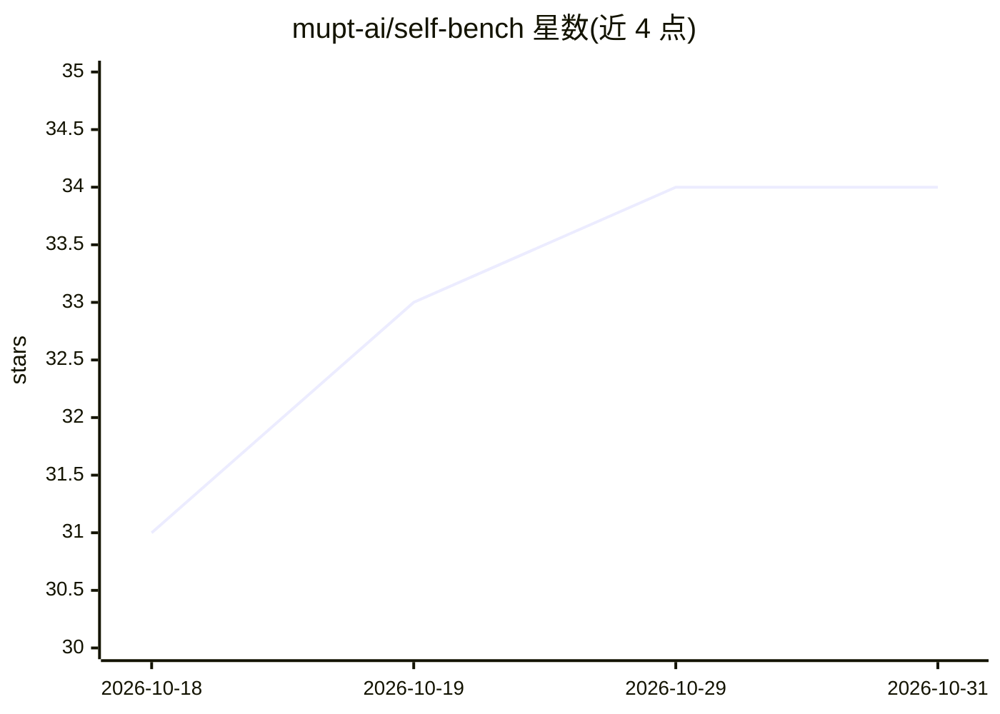

# mupt-ai/self-bench

⭐ 34 · TypeScript · MIT · 推送 2026-10-29 · [GitHub](https://github.com/mupt-ai/self-bench) · [官网](https://selfbench.dev) · 组织维护

**用仓库自身合并 PR 构建私有评测，为代码库选模型**

面向团队与开发者的编码智能体/模型评测平台：从仓库已合并的 PR 出发，由智能体生成隐藏测试与参考解，经多次验证与独立审查后生成 Harbor 格式任务；随后在沙箱中运行所选模型、智能体框架与推理设置，绘制准确率-成本图与 Pareto 前沿。主要通过 app.selfbench.dev 网页应用使用（GitHub 登录、组织自有 API key），也提供基于 GCP + Terraform 的自托管方案；本地开发需 Bun 1.3.14+ 与 Docker Compose。

## 筛选速览

| 维度 | 判定 | 备注 |
|---|---|---|
| AI 角色 | `ai-ecosystem` | LLM/agent 周边工具 |
| 许可风险 | `permissive` | MIT |
| 部署形态 | `self-host` | docker 或自建部署 |
| 模型依赖 | — | README 未给出锁定关系 |
| 硬件要求 | — | 无带数字的原话,不猜 |
| 安装摩擦 | `low` | 无编译、无系统依赖或容器化 |
| 成熟度 | — | 结构信号不足 |

## 能力要点

- 从合并 PR 自动生成带隐藏测试的 Harbor 格式评测任务
- 任务需通过无解失败/有解通过/重跑一致/独立审查四重验证
- 按准确率与成本排名模型、框架与推理设置并绘制 Pareto 前沿
- 支持 GCP + Terraform 自托管与 Docker Compose 本地全栈运行

## 适用场景

- 为自己的代码库筛选最合适的编码模型或智能体
- 把仓库 PR 转化为持续回归的私有评测集
- 对比不同模型与推理设置的成本-准确率权衡
- 将开源仓库的评测结果发布到公开排行榜

## 场景标签

`模型评测` · 领域:评测与运维

## 证据(README 行号)

> L22: Public benchmarks tell you how a model does on someone else's code. SelfBench tells you how it does on yours: it tu
> L34: For each merged PR, SelfBench rebuilds the task from the commit before the change: the PR's own request becomes the
> L44: 5. **Results**: compare accuracy against cost, and open any trial's transcript and scores.

## 星数曲线

2026-10-18 31 → 2026-10-31 34（+3）

---
*卡片 v1 · prompt 1.4 · 生成 2026-10-25 · 置信度 high · 依据 README sha `379db69a5347` · [字段定义](../../DATASET.md)*
