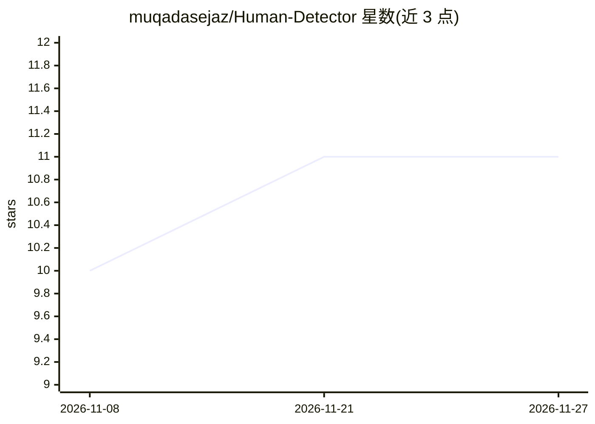

# muqadasejaz/Human-Detector

⭐ 11 · Python · MIT · 推送 2026-05-11 · [GitHub](https://github.com/muqadasejaz/Human-Detector) · [官网](https://person-detection.streamlit.app/) · 个人维护

**用 YOLOv8 实时检测摄像头/视频中人体的 Python 应用**

基于 Ultralytics YOLOv8n/YOLOv8s 的人体检测应用，支持两种输入模式：摄像头实时检测（person_webcam.py）与视频文件离线检测（person_video.py），每帧绘制边界框、标注 Person 1/2 等标签并显示人数总计，按 q 键退出。技术栈为 Python 3.8+、OpenCV 视频处理、PyWin32（Windows mutex 处理），并附 Streamlit 在线演示。安装依赖后直接以 python 命令运行。

## 筛选速览

| 维度 | 判定 | 备注 |
|---|---|---|
| AI 角色 | `ai-native` | 本体是模型或模型工具 |
| 许可风险 | `permissive` | MIT |
| 部署形态 | `None` |  |
| 模型依赖 | — | README 未给出锁定关系 |
| 硬件要求 | — | 无带数字的原话,不猜 |
| 安装摩擦 | `low` | 无编译、无系统依赖或容器化 |
| 成熟度 | — | 结构信号不足 |

## 能力要点

- 摄像头实时检测与视频文件离线检测两种运行模式
- YOLOv8n/YOLOv8s 轻量模型，输出边界框与逐帧人数统计
- 提供 Streamlit 在线演示入口
- 可替换为不同 YOLOv8 变体

## 适用场景

- 用笔记本摄像头实时检测并统计画面中的人数
- 对已有视频文件做离线人体检测
- 作为 YOLOv8 人体检测的入门示例项目阅读运行

## 场景标签

`目标检测` · 领域:感知与多模态

## 证据(README 行号)

> L3: This project demonstrates **real-time human (person) detection** using the **YOLOv8 model** from Ultralytics.
> L7: The goal of this project is to build a **real-time person detection system** using the YOLOv8 deep learning model.
> L28: - 🔍 Detect humans in **real-time** using webcam

## 星数曲线

2026-11-08 10 → 2026-11-27 11（+1）

---
*卡片 v1 · prompt 1.4 · 生成 2026-11-19 · 置信度 high · 依据 README sha `7fdd678d81ca` · [字段定义](../../DATASET.md)*
