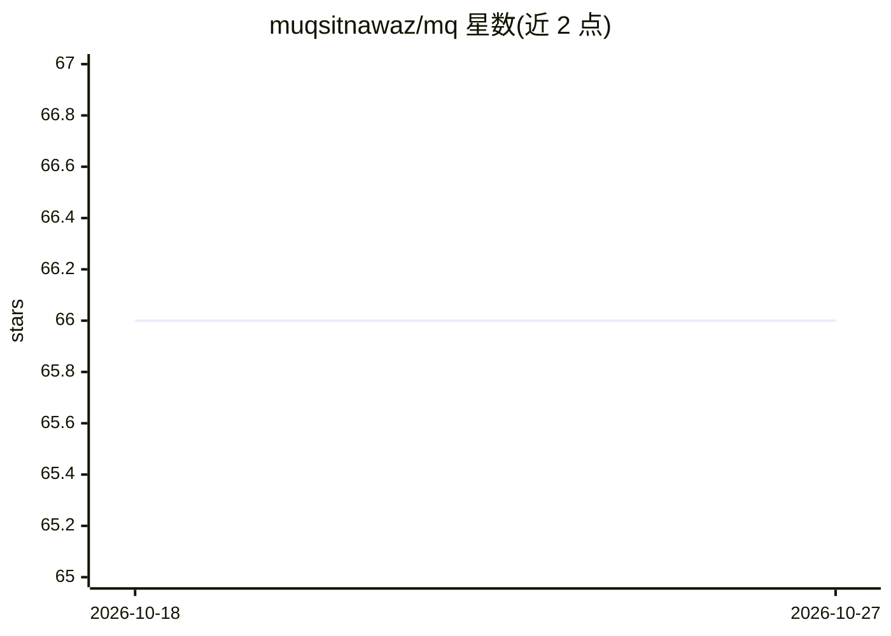

# muqsitnawaz/mq

⭐ 66 · Go · MIT · 推送 2026-07-31 · [GitHub](https://github.com/muqsitnawaz/mq) · 个人维护

**供 AI agent 用的结构化文档查询 CLI，按需提取内容省 token**

面向 AI agent 与编码助手的命令行查询工具：以统一查询语法读取 Markdown/HTML/PDF/JSON/JSONL/YAML 的文档结构（标题、章节、表格、链接等），通过 .tree 输出结构图、.search 精确搜索、管道式抽取片段，使 agent 无需读取全文即可定位内容。不依赖嵌入、向量库或外部 API，输出确定性结果；单二进制无依赖。README 称正确作用域下可减少约 83% 的 markdown token，并附多篇研究引文佐证结构优先思路。

## 筛选速览

| 维度 | 判定 | 备注 |
|---|---|---|
| AI 角色 | `ai-ecosystem` | LLM/agent 周边工具 |
| 许可风险 | `permissive` | MIT |
| 部署形态 | `library` | 以包/库形式分发 |
| 模型依赖 | — | README 未给出锁定关系 |
| 硬件要求 | — | 无带数字的原话,不猜 |
| 安装摩擦 | `low` | 无编译、无系统依赖或容器化 |
| 成熟度 | — | 结构信号不足 |

## 能力要点

- 单一查询模型覆盖 Markdown/HTML/PDF/JSON/JSONL/YAML 六种格式
- 无嵌入、无向量库、无外部 API，输出确定性
- 结构树 + 精确搜索 + 管道式片段抽取，按需提取内容
- 单二进制、无依赖，可被任意可执行 shell 命令的 agent 使用

## 适用场景

- 让 Claude/Cursor/Codex 等 agent 先看文档结构再精准抽取，节省上下文 token
- 在大批量文档/仓库中替代 RAG 做结构优先的检索
- 离线环境（无 API/向量库）下为 agent 提供文档导航

## 场景标签

 · 领域:开发者工具/文档检索

## 证据(README 行号)

> L8: AI agents waste tokens reading entire files. mq lets them query structure first, then extract only what they need. T
> L91: Any AI agent or coding assistant that can execute shell commands.
> L145: mq is an **interface**, not an answer engine. It extracts structure into the agent's context, where the agent can 

## 星数曲线

2026-10-18 66 → 2026-10-27 66（+0）

---
*卡片 v1 · prompt 1.4 · 生成 2026-10-24 · 置信度 mid · 依据 README sha `158ecdd6ee62` · [字段定义](../../DATASET.md)*
