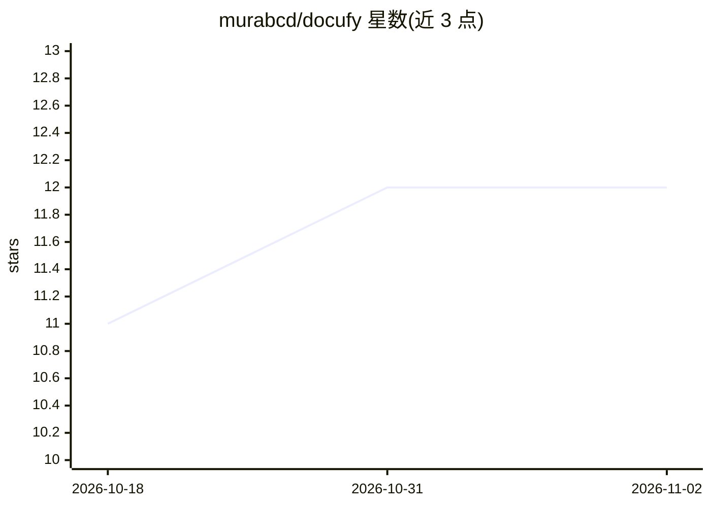

# murabcd/docufy

⭐ 12 · TypeScript · 推送 2026-01-18 · [GitHub](https://github.com/murabcd/docufy) · [官网](https://docufy-oss.vercel.app) · 个人维护

**Notion 风格的协作文档平台，含 AI 搜索与编辑功能**

基于 TanStack Start、TanStack AI 与 Convex 构建的 Notion 式文档平台：Tiptap v3 富文本编辑、Convex ProseMirror Sync 协同编辑、RAG 与全文检索、Better Auth 认证（GitHub OAuth）、Vercel Blob 文件存储。AI 能力包括持久化用户偏好记忆、Jina 实时联网搜索、自然语言检索与编辑工作区文档，默认接入 OpenAI（GPT-4.1 系列），可通过 TanStack AI 切换到 Anthropic、Ollama、Gemini 等提供商。支持一键部署到 Vercel，本地需 Bun 运行并配置环境变量。

## 筛选速览

| 维度 | 判定 | 备注 |
|---|---|---|
| AI 角色 | `ai-enhanced` | 去掉 AI 部分产品仍成立 |
| 许可风险 | `none` | — |
| 部署形态 | `library` | 以包/库形式分发 |
| 模型依赖 | local-ok | 支持本地模型 |
| 硬件要求 | — | 无带数字的原话,不猜 |
| 安装摩擦 | `low` | 无编译、无系统依赖或容器化 |
| 成熟度 | — | 结构信号不足 |

## 能力要点

- 持久化 AI 记忆：存储用户偏好与事实并在对话中上下文检索
- Jina AI 实时联网搜索集成到 AI 工具
- 自然语言对工作区文档进行 AI 搜索、检索与编辑
- Convex 协同编辑与文档 RAG/全文检索

## 适用场景

- 自部署一个带 AI 助手的团队协作文档平台
- 通过自然语言搜索和编辑我的工作区文档
- 需要 AI 具备实时联网信息检索能力的笔记工作台

## 场景标签

`知识库管理` `语义搜索` · 领域:知识与检索

## 证据(README 行号)

> L2:  Notion-like Platform Built with TanStack Start, TanStack AI and Convex.
> L8: - Persistent AI memory that stores user preferences and facts, with contextual retrieval during conversations
> L10: - AI-powered search, retrieval, and editing of workspace documents through natural language

## 星数曲线

2026-10-18 11 → 2026-11-02 12（+1）

---
*卡片 v1 · prompt 1.4 · 生成 2026-11-01 · 置信度 mid · 依据 README sha `1d4a65ce9b00` · [字段定义](../../DATASET.md)*
