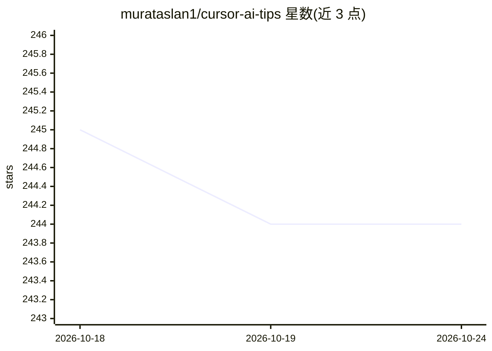

# murataslan1/cursor-ai-tips

⭐ 245 · 推送 2026-03-12 · [GitHub](https://github.com/murataslan1/cursor-ai-tips) · 个人维护

**Cursor AI IDE 使用技巧与最佳实践清单（英文维护）**

面向 Cursor AI IDE 用户的技巧/最佳实践知识库：覆盖 Cursor 2.0-2.6 新功能（Plan Mode、Automations 触发器、Long-Running Agents、Subagents、Composer 1.5）、2026 年模型对比（Claude Opus 4.6 / GPT-5.4 / DeepSeek V4 Lite 等）、Revert Bug 规避协议与防御性提交、Lovable+Cursor 工作流、Playwright+MCP 自愈测试工作流及企业功能说明。内容含大量日期为 2025-2026 的表述，读者需自行核实时效性。MIT 许可，PR 开放。

## 筛选速览

| 维度 | 判定 | 备注 |
|---|---|---|
| AI 角色 | `ai-knowledge` | 知识聚合/清单类 |
| 许可风险 | `permissive` | — |
| 部署形态 | `None` |  |
| 模型依赖 | — | README 未给出锁定关系 |
| 硬件要求 | — | 无带数字的原话,不猜 |
| 安装摩擦 | `low` | 无编译、无系统依赖或容器化 |
| 成熟度 | — | 结构信号不足 |

## 能力要点

- 按版本（2.0-2.6）组织的功能变更与弃用清单
- 2026 模型对比表（SWE-bench、上下文长度、成本）
- Revert Bug 规避操作表与防御性 git 提交命令
- Lovable+Cursor、PlayWhite（Playwright+MCP）工作流说明

## 适用场景

- 查 Cursor 各版本新功能与弃用功能
- 选择适合任务的模型并规划预算
- 规避 Revert Bug 等已知问题

## 场景标签

`精选清单` · 领域:学习与行业

## 证据(README 行号)

> L11: **The ultimate guide to mastering Cursor AI IDE**
> L15: ⚠️ Max Mode Alert • 🆕 Cursor 2.6 • 🆕 Cursor 2.4 • ⚔️ 2026 Models • 🎭 PlayWhite • Shortcuts • Composer • MCP • Enter

## 星数曲线

2026-10-18 245 → 2026-10-24 244（-1）

---
*卡片 v1 · prompt 1.4 · 生成 2026-10-22 · 置信度 high · 依据 README sha `30773c4e80f4` · [字段定义](../../DATASET.md)*
