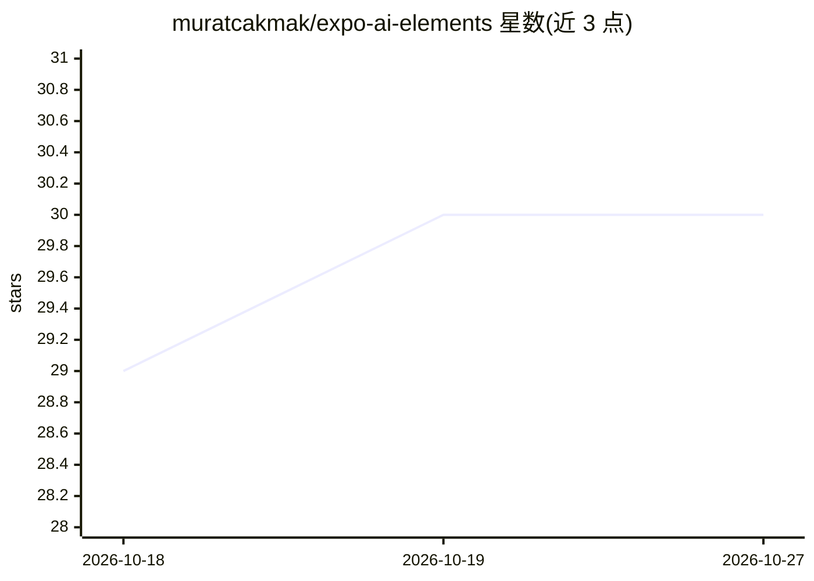

# muratcakmak/expo-ai-elements

⭐ 30 · TypeScript · MIT · 推送 2026-07-08 · [GitHub](https://github.com/muratcakmak/expo-ai-elements) · 个人维护

**给 React Native 开发者的 25 个 AI 聊天 UI 组件库**

Vercel AI Elements 的 React Native 移植版，提供 25 个可复制的 AI 聊天界面组件，覆盖聊天消息、流式 Markdown 与 LaTeX 渲染、代码块、推理轨迹、工具调用可视化、思维链、Agent 计划等 6 大类。组件遵循 shadcn/ui 复制粘贴模式，代码归用户所有；兼容 Vercel AI SDK 的 useChat/useCompletion hooks。可通过 npx CLI 逐个添加组件或 npm 安装整包，前置要求项目已配置 Uniwind 与 React Native Reusables。仓库含完整演示应用。已知限制：流式渲染有约 80ms 节流的卡顿问题，LaTeX 块级公式需指定 github flavor。

## 筛选速览

| 维度 | 判定 | 备注 |
|---|---|---|
| AI 角色 | `ai-ecosystem` | LLM/agent 周边工具 |
| 许可风险 | `permissive` | MIT |
| 部署形态 | `library` | 以包/库形式分发 |
| 模型依赖 | — | README 未给出锁定关系 |
| 硬件要求 | — | 无带数字的原话,不猜 |
| 安装摩擦 | `low` | 无编译、无系统依赖或容器化 |
| 成熟度 | — | 结构信号不足 |

## 能力要点

- 25 个组件分 6 类：聊天/代码/推理/内容/输入/工具
- 流式 Markdown 渲染，支持内联与块级 LaTeX 数学公式
- shadcn/ui 复制粘贴模式，用户拥有全部代码
- 兼容 Vercel AI SDK（useChat / useCompletion hooks）

## 适用场景

- 为移动应用快速搭建 AI 聊天界面
- 展示模型推理轨迹、工具调用与 Agent 执行步骤
- 在聊天中渲染带语法高亮的代码块与数学公式

## 场景标签

 · 领域:移动端 AI 界面组件

## 证据(README 行号)

> L7: **Open-source AI chat UI components for React Native** — bring ChatGPT-level interfaces to your mobile app in minute
> L23: - **Vercel AI SDK compatible** — works with `useChat` and `useCompletion` hooks

## 星数曲线

2026-10-18 29 → 2026-10-27 30（+1）

---
*卡片 v1 · prompt 1.4 · 生成 2026-10-26 · 置信度 high · 依据 README sha `9517ab881510` · [字段定义](../../DATASET.md)*
