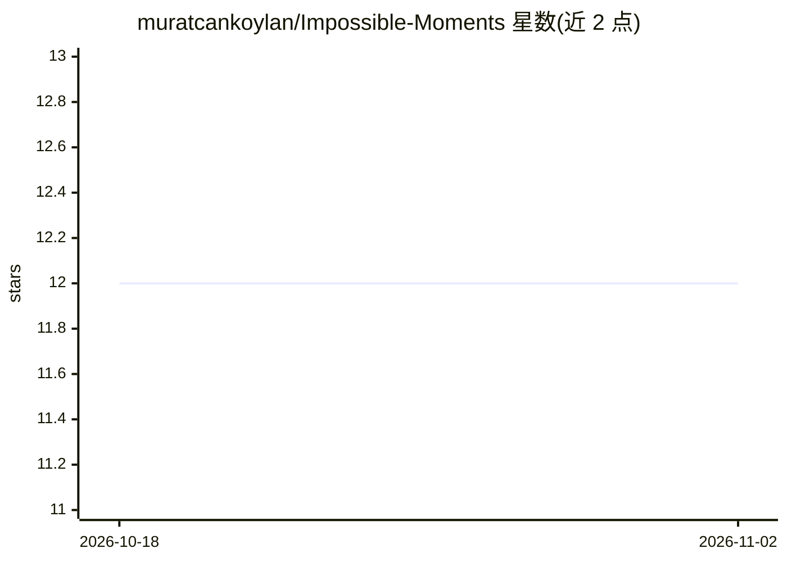

# muratcankoylan/Impossible-Moments

⭐ 12 · Python · MIT · 推送 2026-02-17 · [GitHub](https://github.com/muratcankoylan/Impossible-Moments) · 个人维护

**420 情境的 AGI 创造性约束满足评测基准数据集**

Impossible Moments（IM）是面向 AI 系统的创造性约束满足与推理基准：420 个叙事化情境，表面无解，要求被测模型打破功能固着、做物理/领域推理、拒绝干扰项并串联洞见。按 12 个类别、6 种解状态（从已知解到可证不可能）、5 个难度层级三维组织，每个情境含物理或领域验证、时序分析与创建推理轨迹。由五个专门 agent（Athena/Galileo/Euler/Newton/Socrates）经六阶段流水线生成，数据集托管于 HuggingFace。README 未展示针对本产品的安装或运行命令。

## 筛选速览

| 维度 | 判定 | 备注 |
|---|---|---|
| AI 角色 | `ai-knowledge` | 知识聚合/清单类 |
| 许可风险 | `permissive` | MIT |
| 部署形态 | `None` |  |
| 模型依赖 | — | README 未给出锁定关系 |
| 硬件要求 | — | 无带数字的原话,不猜 |
| 安装摩擦 | `low` | 无编译、无系统依赖或容器化 |
| 成熟度 | — | 结构信号不足 |

## 能力要点

- 420 个情境，覆盖物理/工程与商业/经济/交易两个领域
- 12 类别 × 6 解状态 × 5 难度层级的三维组织结构
- 六维难度画像（I.D.C.B.T.X）与 IM-Score 加权设计
- 五个专门 agent 的六阶段创建流水线，推理轨迹完整保留可审计

## 适用场景

- 评测前沿 LLM 在创造性物理约束满足上的表现
- 研究模型对可证不可能问题的严谨证伪能力
- 考察模型拒绝干扰信息、避免幻觉的能力

## 场景标签

`模型评测` · 领域:评测与运维

## 证据(README 行号)

> L21: **Impossible Moments (IM)** is designed to provoke exactly that rupture and to measure whether it occurs. The bench
> L100: The benchmark contains **420 scenarios** distributed across all 12 categories, 6 solution statuses, and 5 difficul

## 星数曲线

2026-10-18 12 → 2026-11-02 12（+0）

---
*卡片 v1 · prompt 1.4 · 生成 2026-11-01 · 置信度 high · 依据 README sha `ebf8ed28dea5` · [字段定义](../../DATASET.md)*
