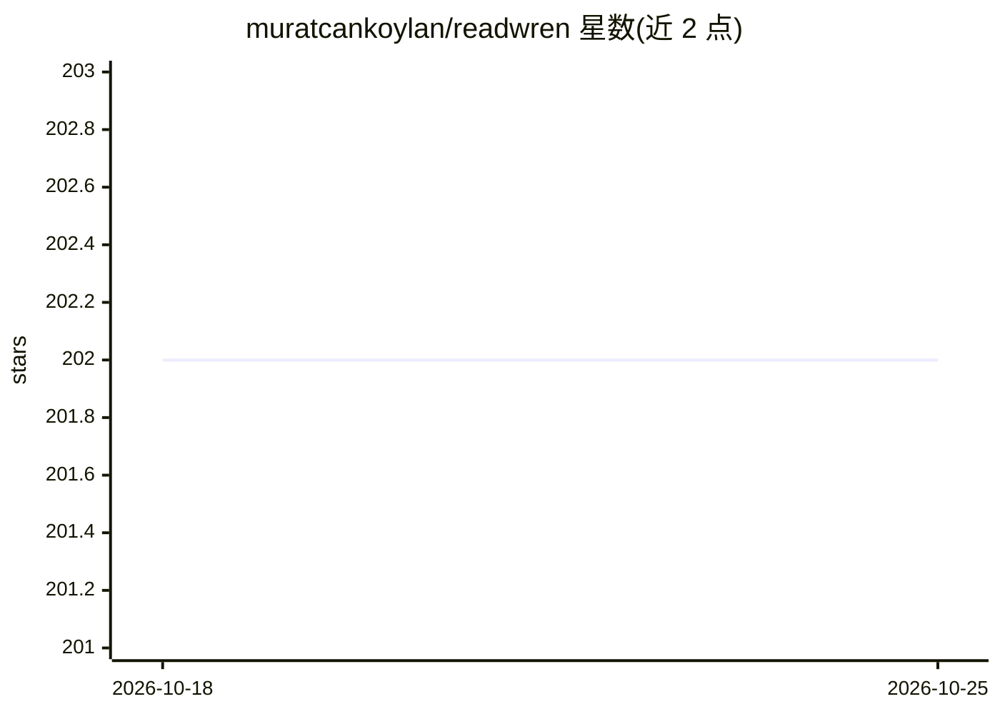

# muratcankoylan/readwren

⭐ 202 · Python · MIT · 推送 2025-11-09 · [GitHub](https://github.com/muratcankoylan/readwren) · 个人维护

**对话式访谈生成文学品味结构化档案的多 agent 应用**

面向 LLM 用户的 CLI 访谈应用：通过 12 轮自适应对话（InterviewAgent，kimi-k2-thinking-turbo）提取用户文学偏好，由 ProfileGeneratorAgent（kimi-k2-thinking）将对话转写为含 40+ 数据点的 JSON 档案，并输出 Markdown、可分享文本与带推理过程的对话日志 4 种格式。基于 LangGraph 状态机管理流程，实现自定义 Redis checkpointer 做会话持久化（可选，24 小时过期）。需 Moonshot API key，git clone 源码运行，Python 3.11+。

## 筛选速览

| 维度 | 判定 | 备注 |
|---|---|---|
| AI 角色 | `ai-native` | 本体是模型或模型工具 |
| 许可风险 | `permissive` | MIT |
| 部署形态 | `None` |  |
| 模型依赖 | — | README 未给出锁定关系 |
| 硬件要求 | — | 无带数字的原话,不猜 |
| 安装摩擦 | `low` | 无编译、无系统依赖或容器化 |
| 成熟度 | — | 结构信号不足 |

## 能力要点

- 12 轮自适应访谈提取品味锚点、风格签名等 5 维信息
- 双 agent 分工：turbo 模型做对话、thinking 模型做一次深度分析
- 自定义 Redis checkpointer 支持会话恢复与中断续接
- 输出 JSON/Markdown/可分享文本/对话日志 4 种格式，档案可交给任意 LLM 使用

## 适用场景

- 我想要一份能交给任意 LLM 的个人文学偏好档案
- 让 AI 写出符合我口味的故事或文章
- 研究文学品味如何被结构化表达

## 场景标签

`多智能体` · 领域:Agent 开发

## 证据(README 行号)

> L3: **An adaptive multi-agent system that extracts your literary DNA through conversation and generates actionable readi
> L13: **The Solution**: WREN conducts a 12-turn adaptive interview that:
> L260: Once generated, give your profile to any LLM:

## 星数曲线

2026-10-18 202 → 2026-10-25 202（+0）

---
*卡片 v1 · prompt 1.4 · 生成 2026-10-22 · 置信度 high · 依据 README sha `4165b7bdbbab` · [字段定义](../../DATASET.md)*
