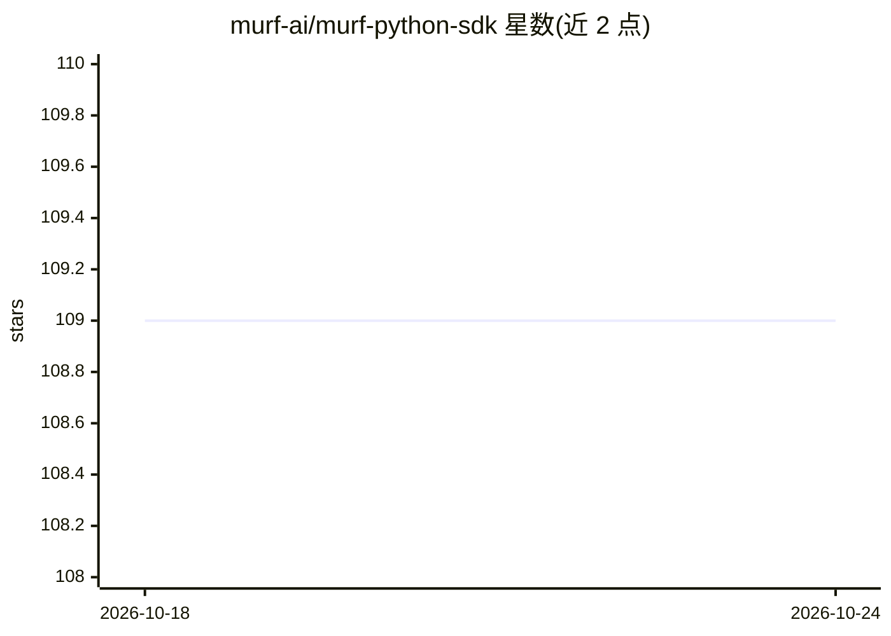

# murf-ai/murf-python-sdk

⭐ 109 · Python · MIT · 推送 2026-03-05 · [GitHub](https://github.com/murf-ai/murf-python-sdk) · [官网](https://murf.ai/api/docs) · 组织维护

**Murf 文本转语音 API 的 Python 客户端 SDK**

面向开发者的 Python SDK，封装 Murf AI 托管的文本转语音 HTTP API：将文本转换为语音，提供 21 种语言 130+ 声音、20+ 说话风格，可调节音高/语速/停顿/发音，输出 MP3、WAV 等格式并支持流式生成。SDK 提供同步与 AsyncMurf 异步客户端，内置指数退避自动重试（默认 2 次，408/429/5XX 触发）、默认 60 秒超时可配置，并可替换底层 httpx 客户端以支持代理。API key 与配额由 Murf 云服务提供，本地不运行模型。

## 筛选速览

| 维度 | 判定 | 备注 |
|---|---|---|
| AI 角色 | `ai-ecosystem` | LLM/agent 周边工具 |
| 许可风险 | `permissive` | MIT |
| 部署形态 | `library` | 以包/库形式分发 |
| 模型依赖 | — | README 未给出锁定关系 |
| 硬件要求 | — | 无带数字的原话,不猜 |
| 安装摩擦 | `low` | 无编译、无系统依赖或容器化 |
| 成熟度 | — | 结构信号不足 |

## 能力要点

- 封装 Murf TTS API，130+ 声音、21 种语言、20+ 说话风格
- 同步与 AsyncMurf 异步客户端，支持非阻塞与流式音频生成
- 自动重试（指数退避）与可配置超时
- 可自定义 httpx 客户端（代理、传输层）

## 适用场景

- 在 Python 应用中集成文本转语音功能
- 异步或流式场景下生成语音音频
- 多语言内容配音与音频格式输出

## 场景标签

`语音合成` · 领域:内容生成

## 证据(README 行号)

> L13: The Murf Python SDK offers seamless integration with the Murf AI text-to-speech software, enabling developers and c
> L40: - **Text-to-Speech Conversion:** Transform text into natural-sounding speech.

## 星数曲线

2026-10-18 109 → 2026-10-24 109（+0）

---
*卡片 v1 · prompt 1.4 · 生成 2026-10-23 · 置信度 high · 依据 README sha `526091ecfe85` · [字段定义](../../DATASET.md)*
