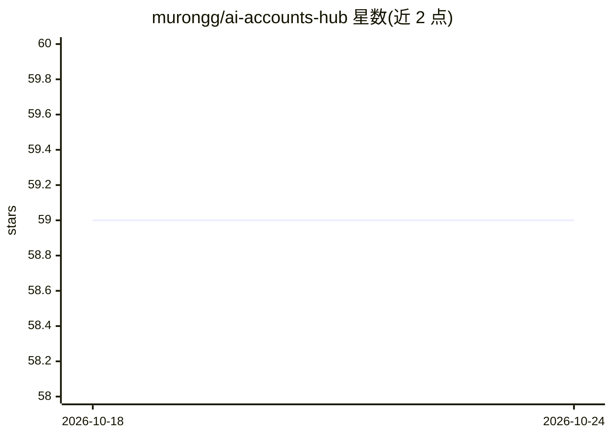

# murongg/ai-accounts-hub

⭐ 59 · Rust · MIT · 推送 2026-05-25 · [GitHub](https://github.com/murongg/ai-accounts-hub) · [官网](https://ai-accounts-hub.vercel.app) · 个人维护 · 中文 README

**AI CLI 账号管理工具：统一托管并切换 Codex/Claude/Gemini 登录态**

Tauri 桌面端与 npm 安装的 aah CLI 双形态工具，面向同时使用多个 Codex/Claude/Gemini CLI 账号的用户。把各 provider 登录态收进应用账号池，切换时把选中账号凭证同步回 ~/.codex、~/.claude、~/.gemini 等系统路径；后台定时刷新 quota/usage 快照，支持配额耗尽时自动切换，另有仅监听 127.0.0.1、当前只路由 Codex 的本地 relay。CLI 提供 TUI、JSON 输出、诊断、安全元数据导入导出与自升级。体验以 macOS 为主，Windows x64 处于第一阶段适配，menubar 能力仅 macOS 可用。

## 筛选速览

| 维度 | 判定 | 备注 |
|---|---|---|
| AI 角色 | `ai-ecosystem` | LLM/agent 周边工具 |
| 许可风险 | `permissive` | MIT |
| 部署形态 | `desktop` | 安装包/桌面程序 |
| 模型依赖 | — | README 未给出锁定关系 |
| 硬件要求 | — | 无带数字的原话,不猜 |
| 安装摩擦 | `low` | 无编译、无系统依赖或容器化 |
| 成熟度 | `idea` | |

## 能力要点

- Codex/Claude/Gemini 多账号托管与系统 live 凭证一键切换
- 后台定时刷新 quota/usage 快照并支持配额耗尽自动切换
- 本地 relay 提供统一 Codex 兼容入口（仅 127.0.0.1，仅 Codex 路由）
- 桌面端与 CLI 共用账号池，CLI 支持自动填充登录与安全元数据导入导出

## 适用场景

- 在一台机器上维护并快速切换多个 Codex/Claude/Gemini CLI 账号
- 切换前查看各账号剩余额度与 relogin 状态
- 让 opencode 等兼容工具通过本地 relay 使用托管的 Codex 账号

## 场景标签

 · 领域:AI CLI 工具/账号管理

## 证据(README 行号)

> L20: 它把 `Codex`、`Claude`、`Gemini` 的多个登录态收进应用自己的账号池，并在需要时把选中的账号同步回系统 CLI 配置，让你可以在一台机器上快速切换“当前活跃账号”，同时查看各 provider 的配额或 us
> L24: - **桌面 App 模式**：用图形界面统一管理账号、切换系统当前凭证、查看 quota / usage、配置自动切换和本地中转服务。
> L94: 应用默认的工作方式不是“代理所有请求”，而是“托管账号凭证并切换系统当前账号”。

## 星数曲线

2026-10-18 59 → 2026-10-24 59（+0）

---
*卡片 v1 · prompt 1.4 · 生成 2026-10-24 · 置信度 high · 依据 README sha `7c82dc9a86be` · [字段定义](../../DATASET.md)*
