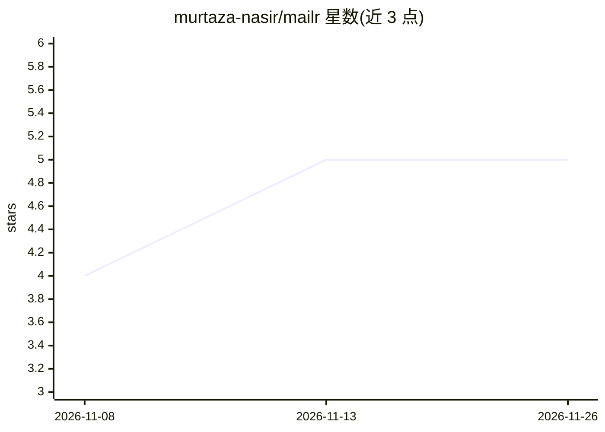

# murtaza-nasir/mailr

⭐ 5 · Python · AGPL-3.0 · 推送 2026-11-23 · [GitHub](https://github.com/murtaza-nasir/mailr) · [官网](https://murtaza-nasir.github.io/mailr/) · 个人维护

**自托管 webmail：邮件存储/日历/任务/笔记加 AI 助手**

自托管 webmail 应用，通过 IMAP/SMTP 连接一个或多个邮件服务商，将邮件副本保存到本地邮件存储（内置 Stalwart 服务器），无需 MX 记录或开放邮件端口。功能覆盖对话式邮件阅读、标签与学习式分诊、日历/任务/笔记、Gmail 导入与 mbox/Maildir 导入，并提供 Android 应用。内置助手 Ambrose 可检索邮件、生成摘要与回复草稿，发送/删除/规则变更默认需用户批准。模型通过 OpenAI 兼容端点接入，可本地运行，也可完全不用模型。部署要求 Linux 主机加 Docker Compose v2 与 BuildKit。

## 筛选速览

| 维度 | 判定 | 备注 |
|---|---|---|
| AI 角色 | `ai-enhanced` | 去掉 AI 部分产品仍成立 |
| 许可风险 | `dual` | AGPL-3.0 |
| 部署形态 | `self-host` | docker 或自建部署 |
| 模型依赖 | — | README 未给出锁定关系 |
| 硬件要求 | — | 无带数字的原话,不猜 |
| 安装摩擦 | `low` | 无编译、无系统依赖或容器化 |
| 成熟度 | — | 结构信号不足 |

## 能力要点

- IMAP/SMTP 同步到本地邮件存储，三种账户模式（保持同步/长期存储/一次性复制）
- 助手 Ambrose：问答带引用链接、/sweep 批量审阅、按个人风格起草，操作默认需批准
- 模型经 OpenAI 兼容端点接入，本地或托管均可，local-only 账户不出本地
- REST API 与 MCP 服务器，带作用域令牌、审批与审计日志

## 适用场景

- 在自己的服务器上托管多个邮件账户的收件箱和存档
- 让 AI 助手整理收件箱并代拟回复，敏感邮件走本地模型
- 导入旧 Gmail 或 mbox 归档做长期保存
- 在手机上查看邮件日历并远程批准 AI 操作

## 场景标签

`AI 助手` · 领域:对话与助手

## 证据(README 行号)

> L18: Mailr is a webmail application for hosting your mail inbox and mail storage on your own server.
> L23: Mailr also includes a calendar, task lists, notes and an AI assistant named Ambrose. Ambrose
> L27: AI assistance than most webmail applications. The language and embedding models used by

## 星数曲线

2026-11-08 4 → 2026-11-26 5（+1）

---
*卡片 v1 · prompt 1.4 · 生成 2026-11-21 · 置信度 high · 依据 README sha `15302796ad23` · [字段定义](../../DATASET.md)*
