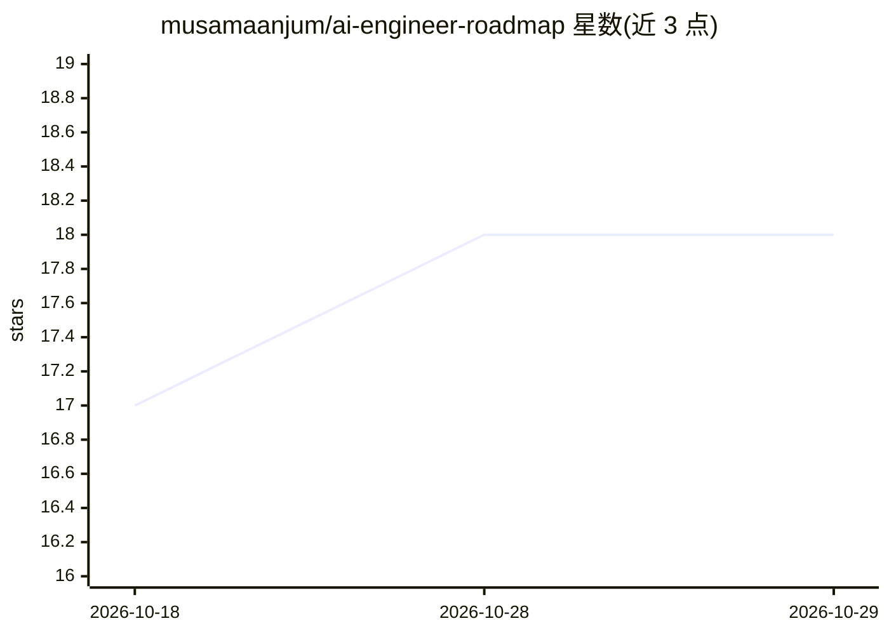

# musamaanjum/ai-engineer-roadmap

⭐ 18 · 推送 2026-03-02 · [GitHub](https://github.com/musamaanjum/ai-engineer-roadmap) · 个人维护

**软件工程师转 AI/LLM 工程师的学习路线图与资源清单**

面向已掌握 Python 与基础 ML 的软件工程师，提供成为 AI/LLM 工程师的分阶段学习路线：四个阶段覆盖 Transformer/LLM 基础、核心 LLM 工程（RAG、微调、agents）、生产技能（LLMOps、部署）与专项方向，每阶段列出免费/付费课程与时长难度；另给出 5 个作品集项目规格（RAG 问答、领域微调、多 agent 系统、LLM 评测框架、生产级应用）与面试准备资源。前提要求为中级以上 Python、软件工程经验、至少一门 ML 课程与大学水平数学。

## 筛选速览

| 维度 | 判定 | 备注 |
|---|---|---|
| AI 角色 | `ai-knowledge` | 知识聚合/清单类 |
| 许可风险 | `none` | — |
| 部署形态 | `None` |  |
| 模型依赖 | — | README 未给出锁定关系 |
| 硬件要求 | — | 无带数字的原话,不猜 |
| 安装摩擦 | `low` | 无编译、无系统依赖或容器化 |
| 成熟度 | — | 结构信号不足 |

## 能力要点

- 四阶段课程表，标注平台/时长/费用/难度
- 5 个作品集项目规格，含技术栈与展示要点
- 面试准备资源表（ML/LLM 面试题库）
- 明确前置技能要求与目标岗位（AI/LLM/ML 工程师）

## 适用场景

- 按阶段规划从软件工程师转 AI 工程师的学习路径
- 挑选作品集项目以充实求职简历
- 准备 AI/LLM 工程师岗位面试

## 场景标签

`精选清单` `教程课程` · 领域:学习与行业

## 证据(README 行号)

> L10: **A structured, no-fluff roadmap for software engineers who want to break into AI, LLM, and Generative AI roles.**
> L26: **This roadmap fixes all of that.** It is designed specifically for **software engineers who already know Python an

## 星数曲线

2026-10-18 17 → 2026-10-29 18（+1）

---
*卡片 v1 · prompt 1.4 · 生成 2026-10-29 · 置信度 high · 依据 README sha `13aa12cb8f06` · [字段定义](../../DATASET.md)*
