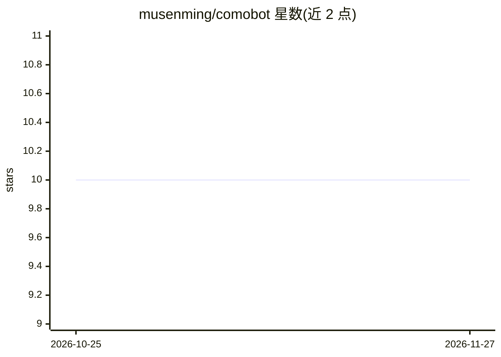

# musenming/comobot

⭐ 10 · Python · NOASSERTION · 推送 2026-04-02 · [GitHub](https://github.com/musenming/comobot) · 个人维护 · 中文 README

**私有化部署的多渠道智能体引擎，支持编排与多模型路由**

Comobot 是 ComindX 的核心执行引擎，定位为可私有化部署的智能体（Agent）运行框架：通过 onboarding 初始化后可接入 Telegram、Discord、飞书、钉钉等九类渠道，执行面由 AgentLoop 承担推理、工具调用与记忆整合，控制面提供 Web 控制台进行模板与流程图两种模式的可视化编排。模型接入基于 LiteLLM 生态，支持多 Key 轮询调度。提供 CLI、API、网关、Web 四种运行形态，数据落 SQLite，配置与数据本地优先。

## 筛选速览

| 维度 | 判定 | 备注 |
|---|---|---|
| AI 角色 | `ai-ecosystem` | LLM/agent 周边工具 |
| 许可风险 | `none` | NOASSERTION |
| 部署形态 | `self-host` | docker 或自建部署 |
| 模型依赖 | — | README 未给出锁定关系 |
| 硬件要求 | — | 无带数字的原话,不猜 |
| 安装摩擦 | `low` | 无编译、无系统依赖或容器化 |
| 成熟度 | — | 结构信号不足 |

## 能力要点

- 九类渠道统一接入的 ChannelManager
- 基于 LiteLLM 的多模型兼容与多 Key 轮询
- 模板与流程图双模式的可视化编排（Web）
- JWT 鉴权、AES-256-GCM 凭证加密、SQLite + WAL

## 适用场景

- 搭建可私有化部署的多渠道对话智能体
- 零代码模板起步并按需演进到流程编排
- 多模型服务间做 Key 轮询与请求调度

## 场景标签

`Agent 框架` `聊天机器人` · 领域:Agent 开发

## 证据(README 行号)

> L1: # Comobot · 智能体引擎
> L29: ### 3) 多模型与路由能力
> L46: Web UI (Vue3)  <->  FastAPI API  <->  AgentLoop / Orchestrator

## 星数曲线

2026-10-25 10 → 2026-11-27 10（+0）

---
*卡片 v1 · prompt 1.4 · 生成 2026-11-19 · 置信度 high · 依据 README sha `d81e44386b3d` · [字段定义](../../DATASET.md)*
