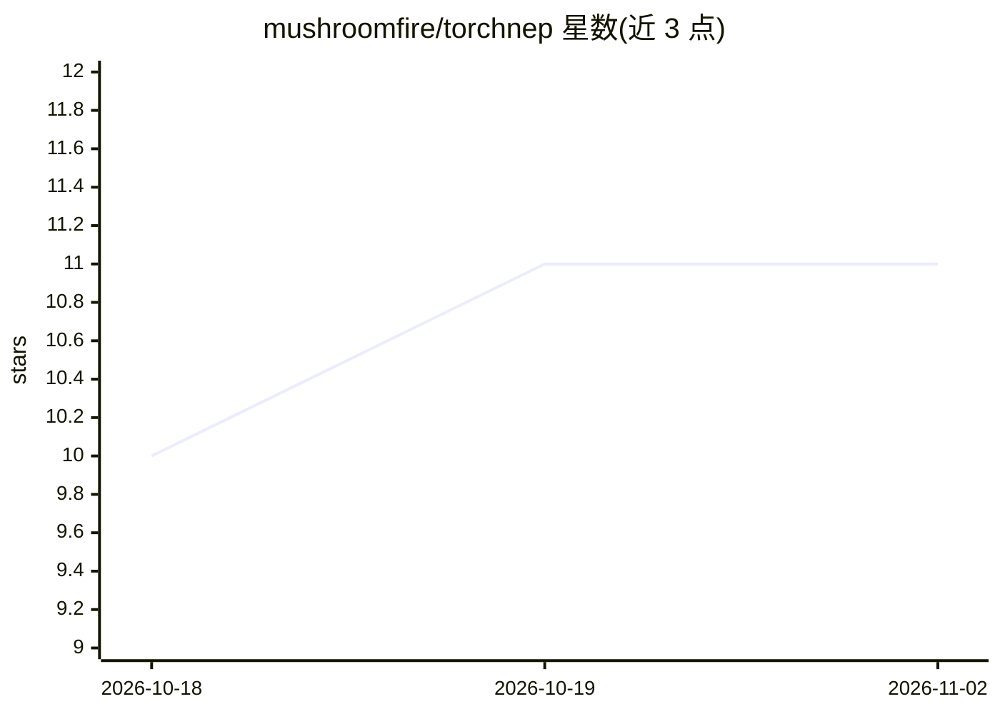

# mushroomfire/torchnep

⭐ 11 · Python · GPL-3.0 · 推送 2026-10-20 · [GitHub](https://github.com/mushroomfire/torchnep) · [官网](https://mushroomfire.github.io/torchnep/) · 组织维护

**PyTorch 训练 NEP 机器学习原子间势的工具库**

NEP4 神经进化势架构的从零实现，面向原子尺度模拟研究者：在 PyTorch 中训练机器学习原子间势，产出的 nep.txt 可直接载入 GPUMD 进行分子动力学。采用两阶段训练（先力后能量），支持多 GPU/多节点数据并行与 torch.compile 后端自动选择（CUDA 与 ROCm），数据集驻留主机内存以降低显存占用；另提供微调、ZBL 短程排斥、绘图与基于 MaxVol 外推度的主动学习。经 pip 安装，需先装对应硬件的 PyTorch。

## 筛选速览

| 维度 | 判定 | 备注 |
|---|---|---|
| AI 角色 | `ai-native` | 本体是模型或模型工具 |
| 许可风险 | `viral` | GPL-3.0 |
| 部署形态 | `library` | 以包/库形式分发 |
| 模型依赖 | — | README 未给出锁定关系 |
| 硬件要求 | — | 无带数字的原话,不猜 |
| 安装摩擦 | `medium` | 含编译或系统依赖之一 |
| 成熟度 | — | 结构信号不足 |

## 能力要点

- NEP4 架构从零实现，nep.txt 直接载入 GPUMD
- 两阶段训练：先力后能量
- 多 GPU/多节点数据并行，torch.compile 自动选择 CUDA/ROCm 后端
- MaxVol 外推度主动学习挑选值得 DFT 计算的 MD 帧

## 适用场景

- 用 PyTorch 训练 NEP 机器学习原子间势
- 训练好的势函数载入 GPUMD 跑分子动力学
- 主动学习挑选 MD 构型做 DFT 标注以扩充训练集

## 场景标签

 · 领域:计算材料/原子尺度模拟

## 证据(README 行号)

> L20: TorchNEP is a from-scratch implementation of NEP4, the neuroevolution potential architecture.
> L22: - **GPUMD-compatible** — `nep.txt` files load directly into GPUMD for molecular dynamics

## 星数曲线

2026-10-18 10 → 2026-11-02 11（+1）

---
*卡片 v1 · prompt 1.4 · 生成 2026-11-02 · 置信度 high · 依据 README sha `b7cc5386d6b0` · [字段定义](../../DATASET.md)*
