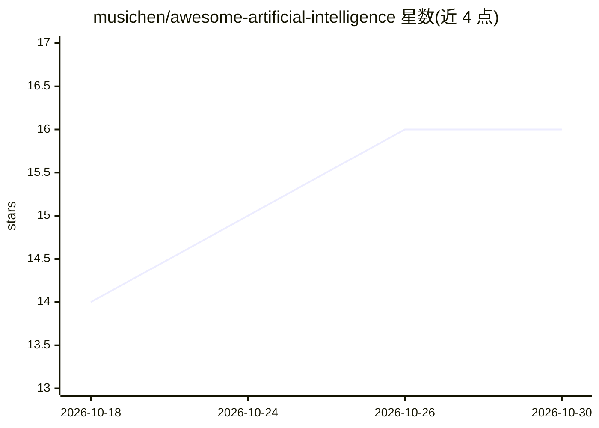

# musichen/awesome-artificial-intelligence

⭐ 16 · Python · MIT · 推送 2026-10-29 · [GitHub](https://github.com/musichen/awesome-artificial-intelligence) · 个人维护

**面向开发者的生成式 AI 与 agent 学习资源精选清单**

由个人维护的 opinionated 资源清单，收录 AI 书籍、课程、基础论文、agent 构建指南、agent 框架、记忆系统、检索工具与代码库知识图谱工具等条目，面向想学习构建、评测与部署生成式 AI 和 agentic 系统的软件开发者。条目按质量门槛人工筛选，并声称由每周运行的证据驱动自动化流程做审查、验证与合并小改动。仅为资源目录，不提供可安装运行的软件本体。

## 筛选速览

| 维度 | 判定 | 备注 |
|---|---|---|
| AI 角色 | `ai-knowledge` | 知识聚合/清单类 |
| 许可风险 | `permissive` | MIT |
| 部署形态 | `None` |  |
| 模型依赖 | — | README 未给出锁定关系 |
| 硬件要求 | — | 无带数字的原话,不猜 |
| 安装摩擦 | `low` | 无编译、无系统依赖或容器化 |
| 成熟度 | — | 结构信号不足 |

## 能力要点

- 覆盖书籍、课程、论文、指南、协议、框架、记忆系统、代码知识图谱工具等类别
- 声明每周由证据驱动自动化流程审查与合并变更
- 设置明确收录质量门槛，非全量产品目录

## 适用场景

- 查找构建 LLM 应用与 agent 系统的学习路径与参考资料
- 了解 agent 框架、记忆系统与代码库理解工具的选型线索
- 追溯 Transformer、RLHF、RAG 等方向的基础论文

## 场景标签

`精选清单` · 领域:学习与行业

## 证据(README 行号)

> L3: An opinionated, actively maintained collection of resources for software developers learning to build and ship gener
> L7: This list is for developers who want to:

## 星数曲线

2026-10-18 14 → 2026-10-30 16（+2）

---
*卡片 v1 · prompt 1.4 · 生成 2026-10-30 · 置信度 high · 依据 README sha `fade119ac63d` · [字段定义](../../DATASET.md)*
