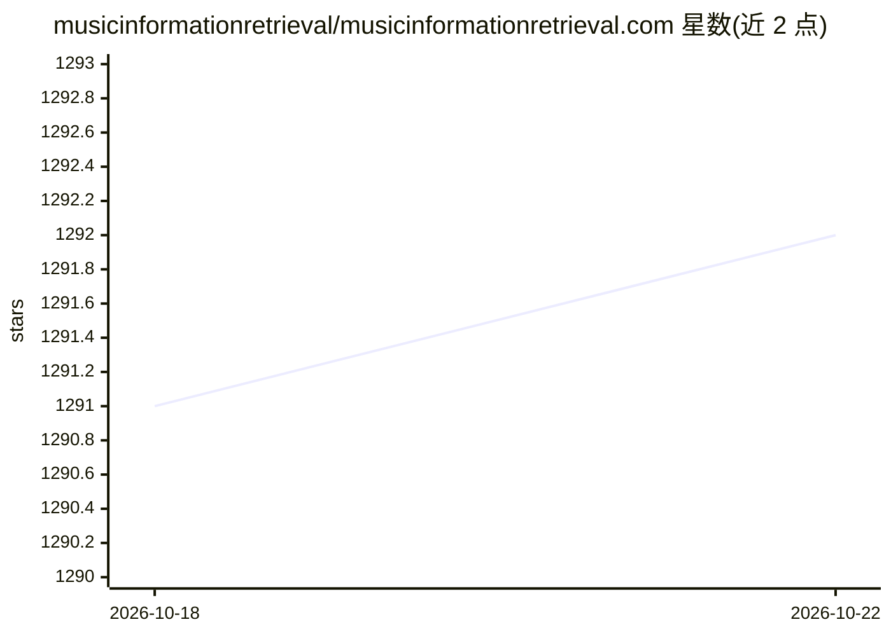

# musicinformationretrieval/musicinformationretrieval.com

⭐ 1,292 · Jupyter Notebook · MIT · 推送 2026-05-19 · [GitHub](https://github.com/musicinformationretrieval/musicinformationretrieval.com) · [官网](http://musicinformationretrieval.com) · 组织维护

**音乐信息检索（MIR）教学笔记本合集网站**

musicinformationretrieval.com 的源码仓库，收录 Jupyter 教学笔记本，用可执行的 Python 代码片段演示音乐信息检索基础系统，内容涵盖音频与符号表示、特征提取（STFT/色度/频谱特征）、节奏与节拍跟踪、机器学习（K-Means/神经网络/流派识别）、评测、动态时间规整、NMF 分解等。笔记本可在 Binder 上运行以获得可复现的计算环境，正在向 Colab 迁移并接受社区贡献。

## 筛选速览

| 维度 | 判定 | 备注 |
|---|---|---|
| AI 角色 | `ai-knowledge` | 知识聚合/清单类 |
| 许可风险 | `permissive` | MIT |
| 部署形态 | `None` |  |
| 模型依赖 | — | README 未给出锁定关系 |
| 硬件要求 | — | 无带数字的原话,不猜 |
| 安装摩擦 | `medium` | 含编译或系统依赖之一 |
| 成熟度 | — | 结构信号不足 |

## 能力要点

- Jupyter 笔记本内含可执行 Python 代码，演示基础 MIR 系统
- 覆盖信号分析、节拍跟踪、机器学习、评测、音频分解等主题
- 支持在 Binder 上以一致环境运行，结果可复现
- 社区可通过 issue 与 pull request 贡献内容

## 适用场景

- 系统学习音乐信息检索的基础概念与代码实现
- 在浏览器中直接运行 MIR 示例代码进行练习
- 作为 MIR 课程或工作坊（CCRMA）的配套教材

## 场景标签

`教程课程` · 领域:学习与行业

## 证据(README 行号)

> L83: This repository contains instructional notebooks related to music information retrieval (MIR). Inside these noteboo
> L44: Machine Learning

## 星数曲线

2026-10-18 1,291 → 2026-10-22 1,292（+1）

---
*卡片 v1 · prompt 1.4 · 生成 2026-10-21 · 置信度 high · 依据 README sha `33b76a5cb747` · [字段定义](../../DATASET.md)*
