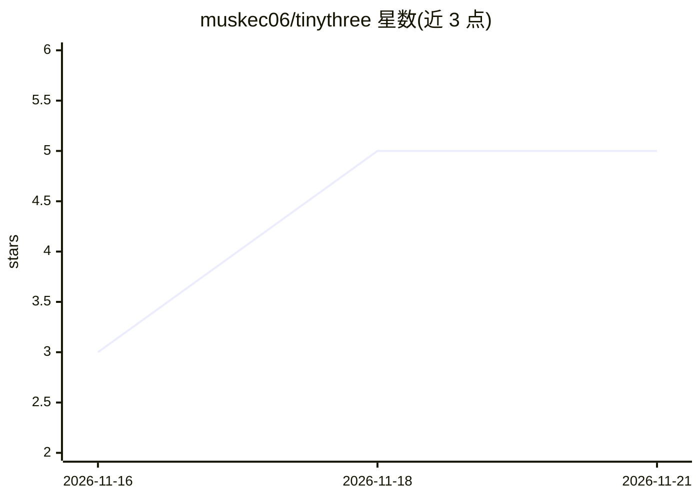

# muskec06/tinythree

⭐ 5 · JavaScript · MIT · 推送 2026-11-17 · [GitHub](https://github.com/muskec06/tinythree) · [官网](https://muskec06.github.io/tinythree/) · 个人维护 · 中文 README

**让 AI 模型以更少 token 编写 3D 场景的 DSL 编译器**

tinythree 是一种编译到 Three.js 的微型 3D 场景语言：`.t3` 文件按行描述形状、材质、复制、动画与相机，由约 800 行、零依赖的编译器生成可直接继续编辑的普通 Three.js 代码。内置 13 个实物部件库、程序化纹理、glTF 模型与逐帧视频渲染（Playwright+ffmpeg），并配有约 1,500 token 的 AI 系统提示词与带修正建议的短报错。使用方式包括浏览器 Playground、贴入 LLM 对话、交给编码 agent、CLI 与 JavaScript API。

## 筛选速览

| 维度 | 判定 | 备注 |
|---|---|---|
| AI 角色 | `ai-ecosystem` | LLM/agent 周边工具 |
| 许可风险 | `permissive` | MIT |
| 部署形态 | `library` | 以包/库形式分发 |
| 模型依赖 | — | README 未给出锁定关系 |
| 硬件要求 | — | 无带数字的原话,不猜 |
| 安装摩擦 | `medium` | 含编译或系统依赖之一 |
| 成熟度 | — | 结构信号不足 |

## 能力要点

- 11 个示例场景实测 token 减少 2.7×–6.9×，总计 3.5×
- 浏览器能力探针 39/39 通过，js/tick/renderer 块可回退到原生 Three.js
- update(t) 为时间纯函数，支持逐帧精确渲染 ProRes 4444 带 alpha 视频
- 同一 .t3 文件可经配套工具生成 Blender 原生场景

## 适用场景

- 让 Claude Code/Codex 等编码 agent 用更少 token 生成可渲染 3D 场景
- 在浏览器 Playground 中边写边预览并导出独立 HTML 页面
- 制作逐帧精确的教学视频与动效图形
- 教学场景演示原子结构与向量加法等概念

## 场景标签

`代码生成` · 领域:编码与开发

## 证据(README 行号)

> L4: Designed so AI models can write 3D scenes with **3–7× fewer tokens**, faster and cheaper.
> L20: tinythree gives the model a notation that only describes the scene: what is where, made of what, moving how. A zero
> L176: ai/SYSTEM_PROMPT.md   compact language description for LLMs (~1.5k tokens)

## 星数曲线

2026-11-16 3 → 2026-11-21 5（+2）

---
*卡片 v1 · prompt 1.4 · 生成 2026-11-21 · 置信度 mid · 依据 README sha `f92809900e1a` · [字段定义](../../DATASET.md)*
